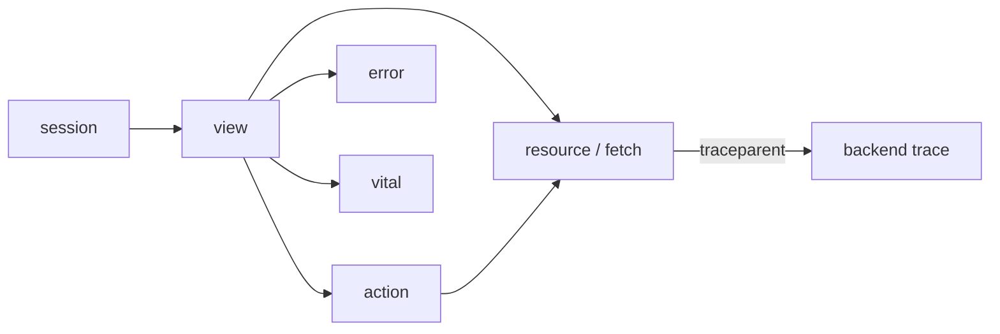

# libo11y RUM

This document is the charter of libo11y RUM and the human-readable form of
its conventions. The conventions are part of spec 1.1.0 and live in the
registry under [`spec/registry`](../spec/registry). Where this document and
the registry disagree, the registry wins. Every RUM group has development
stability. The RUM libraries themselves arrive in later releases, starting
with `@libo11y/rum` in `ts/v0.3.0`.

## Charter

RUM is libo11y's second product. libo11y core wraps OpenTelemetry setup,
and it writes instrumentation only where OpenTelemetry has none to wrap.
RUM is an opinionated real-user-monitoring data model.
It emits pure OTLP through the standard OpenTelemetry API, so any OTLP
backend can store what it records. Its conventions are part of the libo11y
specification. Every RUM platform follows them.

RUM is private by default. Every feature can be switched on or off and
tuned in code. RUM uses upstream instrumentation, such as
`opentelemetry-js-contrib`, where that instrumentation is good. RUM
implements everything that upstream instrumentation does not cover.

## Products and platforms

Core and RUM are products. Each product has one implementation per
platform, and every implementation follows the one specification. Mobile is
a set of new platforms under both products, not a third product.

| Product | Go | Bun and Node | Browser | MV3 extension | React Native | iOS (Swift) | Android (Kotlin) |
|---|---|---|---|---|---|---|---|
| Core (setup) | `go` | `@libo11y/server` | `@libo11y/web` | `@libo11y/webext` | `@libo11y/react-native` | `Libo11y` Swift package | `libo11y-android` |
| RUM (experience) | gateway `go/o11yrum` | none | `@libo11y/rum` | `@libo11y/rum` | `@libo11y/rum-react-native` | `Libo11yRUM` | `libo11y-rum-android` |

Two cells exist today: the Go core (`go`) and the Bun and Node core
(`@libo11y/server`). Every other named cell is planned, including every
package in the RUM row.

## Data model

RUM records six kinds of thing: sessions, views, actions, resources,
errors and vitals.

A session holds views. A view is a page or route on the web and a screen on
mobile. A view holds actions, resources, errors and vitals. An action is a
user interaction, and it links to the requests and the route change it
caused. A resource is a request the view made, and it carries
`traceparent` to the backend so the backend trace joins the view. Every
RUM span and event carries `session.id`. Every span shape and the error
and frustration events also carry `o11y.rum.view.id`, and the session
start and end events do not. With those two attributes the planned gateway
and Grafana session explorer can rebuild the timeline of a session.
Metrics carry neither attribute, because both are unbounded. The registry
defines span shapes for views, actions and app loads. It defines none for
resources yet.

## Conventions

Every name libo11y RUM mints is under `o11y.rum.*`. RUM references the
upstream semconv attributes it uses, such as `session.id`, and never
redefines them. The generator turns the conventions into typed keys and
enums in Go (`go/spec`, for example the key `spec.RUMViewNameKey` and the
enum type `spec.RUMViewKind`) and in TypeScript (`@libo11y/spec`, for
example `ATTR_RUM_VIEW_NAME`).

### Attributes

The platform-neutral attributes are in the group `registry.o11y.rum` in
[`spec/registry/attributes/rum.yaml`](../spec/registry/attributes/rum.yaml).
Every RUM platform uses them.

| Attribute | Type | Sensitivity | Cardinality | Allowed values |
|---|---|---|---|---|
| `o11y.rum.platform` | string | public | enum | `web`, `webext`, `react_native`, `ios`, `android` |
| `o11y.rum.view.name` | string | public | bounded | the route template on the web (never the raw URL), the screen name on mobile |
| `o11y.rum.view.id` | string | internal | unbounded | a random ID for one view instance in a session |
| `o11y.rum.view.kind` | string | public | enum | `initial`, `soft`, `bfcache_restore`, `prerender`, `screen` |
| `o11y.rum.action.type` | string | public | enum | `click`, `tap`, `long_press`, `swipe`, `scroll`, `submit`, `key_press`, `custom` |
| `o11y.rum.action.name` | string | internal | bounded | the element's `data-o11y` label or a privacy-safe accessible name, never text the user typed |
| `o11y.rum.frustration.type` | string | public | enum | `rage`, `dead`, `error` |
| `o11y.rum.error.source` | string | public | enum | `uncaught`, `unhandled_rejection`, `console`, `boundary`, `resource`, `csp`, `network`, `crash`, `anr`, `hang`, `custom` |
| `o11y.rum.error.fingerprint` | string | internal | bounded | a stable grouping key computed after symbolication |
| `o11y.rum.element.selector` | string | internal | unbounded | the selector or view identifier of the UI element |
| `o11y.rum.element.text` | string | pii | unbounded | the visible text of the UI element |
| `o11y.rum.device.class` | string | public | enum | `desktop`, `mobile`, `tablet`, `tv`, `bot`, `unknown` |
| `o11y.rum.connection.type` | string | public | enum | `wifi`, `cellular`, `ethernet`, `offline`, `unknown` |
| `o11y.rum.connection.effective` | string | public | enum | `slow-2g`, `2g`, `3g`, `4g` |
| `o11y.rum.vital.rating` | string | public | enum | `good`, `needs-improvement`, `poor` |
| `o11y.rum.session.retained` | string | public | enum | `head_sampled`, `error`, `frustration` |
| `o11y.rum.replay.segment` | int | public | unbounded | the index of the replay segment in the session |
| `o11y.rum.config.version` | string | public | bounded | the version of the remote configuration the session ran under |

The browser group `registry.o11y.rum.browser` holds the attributes RUM
records only in browsers and browser extensions.

| Attribute | Type | Sensitivity | Cardinality | Allowed values |
|---|---|---|---|---|
| `o11y.rum.browser.family` | string | public | bounded | the browser family the gateway parsed from the user agent, such as `chrome`, `firefox`, `safari`, `edge` or `other` |

The group `libo11y.rum.upstream` classifies the upstream attributes RUM
uses.

| Attribute | Sensitivity | Cardinality |
|---|---|---|
| `session.id` | internal | unbounded |
| `geo.country.iso_code` | public | bounded |

### Span shapes

RUM records three span shapes. Each shape is a group named
`libo11y.rum.span.<shape>` in
[`spec/registry/spans/rum.yaml`](../spec/registry/spans/rum.yaml). The
group's `o11y.rum.span` annotation names the shape. It must be `view`,
`action` or `app_load`, and it must equal the suffix of the group ID.
`make spec-check` enforces both with the rule `libo11y_rum_span_kind`. The
generator writes the required attributes of each shape to
`RUMSpanRequired` in Go and `RUM_SPAN_REQUIRED` in TypeScript. The Go table
is in the internal package `go/internal/spectables`, which the library and
its test harness use and applications cannot import. The TypeScript table
is exported from `@libo11y/spec`.

| Shape | Records | Required attributes | Conditionally required |
|---|---|---|---|
| `view` | each view | `o11y.rum.platform`, `o11y.rum.view.name`, `o11y.rum.view.id`, `o11y.rum.view.kind`, `session.id` | none |
| `action` | each user action | `o11y.rum.action.type`, `o11y.rum.view.id`, `session.id` | `o11y.rum.action.name`, when the element has a `data-o11y` label or a privacy-safe accessible name |
| `app_load` | the document load on the web, the app start on mobile | `o11y.rum.platform`, `o11y.rum.view.id`, `session.id` | none |

### Metrics

The platform-neutral metrics are in
[`spec/registry/metrics/rum.yaml`](../spec/registry/metrics/rum.yaml). The
browser metrics are in
[`spec/registry/metrics/rum-browser.yaml`](../spec/registry/metrics/rum-browser.yaml).
Every label is bounded or an enum. Labels in bold are required. Go has a
name constant for each metric, such as `spec.MetricRUMVitalLCP`, and
TypeScript has one such as `METRIC_RUM_VITAL_LCP`.

| Metric | Instrument | Unit | Labels |
|---|---|---|---|
| `o11y.rum.views` | counter | `{view}` | **`o11y.rum.platform`**, **`o11y.rum.view.name`**, `o11y.rum.view.kind`, `o11y.rum.device.class` |
| `o11y.rum.errors` | counter | `{error}` | **`o11y.rum.platform`**, `o11y.rum.view.name`, **`o11y.rum.error.source`** |
| `o11y.rum.frustrations` | counter | `{signal}` | **`o11y.rum.platform`**, `o11y.rum.view.name`, **`o11y.rum.frustration.type`** |
| `o11y.rum.vital.lcp` | histogram | `s` | the vital labels below |
| `o11y.rum.vital.inp` | histogram | `s` | the vital labels below |
| `o11y.rum.vital.cls` | histogram | `1` | the vital labels below |
| `o11y.rum.vital.fcp` | histogram | `s` | the vital labels below |
| `o11y.rum.vital.ttfb` | histogram | `s` | the vital labels below |
| `o11y.rum.browser.long_animation_frames` | counter | `{frame}` | **`o11y.rum.view.name`** |

The five web vitals share one label set. `o11y.rum.view.name` is required.
The others are `o11y.rum.vital.rating`, `o11y.rum.device.class`,
`o11y.rum.browser.family`, `o11y.rum.connection.effective` and
`geo.country.iso_code`. LCP, INP, FCP and TTFB are durations in seconds.
CLS is a unitless score.

### Events

The RUM events are in
[`spec/registry/logs/events.yaml`](../spec/registry/logs/events.yaml),
next to the core events. RUM also emits the semconv event
`browser.web_vital` as upstream defines it. That event belongs to semconv,
so the registry does not register it.

| Event | Records | Required attributes | Optional attributes |
|---|---|---|---|
| `o11y.rum.error` | an error RUM captured | `o11y.rum.error.source`, `exception.type`, `session.id`, `o11y.rum.view.id` | `o11y.rum.error.fingerprint` |
| `o11y.rum.frustration` | a frustration signal on a UI element | `o11y.rum.frustration.type`, `session.id`, `o11y.rum.view.id` | `o11y.rum.element.selector` |
| `o11y.rum.session.start` | the start of a session | `session.id`, `o11y.rum.platform` | none |
| `o11y.rum.session.end` | the end of a session | `session.id`, `o11y.rum.session.retained` | none |

## Growing the conventions

The centre of the conventions is platform-neutral, and its enums already
cover mobile, such as screens, taps, crashes and ANRs. A new platform adds
enum values to a centre attribute, or it adds a platform group of its own.
The browser group `registry.o11y.rum.browser` is the first platform group.
The mobile steps will add mobile vitals as further `o11y.rum.vital.*`
histograms. A new platform never renames a centre attribute.

A rename from 1.0.0 on needs a transform in the schema file, so that
consumers of older versions can translate the old name. The generator
cannot render transforms yet. Until it can, `make spec-check` refuses such
a rename with the rule `libo11y_rename_needs_transform`. A new span shape
needs a change to the spec checker too, because `libo11y_rum_span_kind`
accepts only `view`, `action` and `app_load`.

## Privacy

`o11y.rum.element.text` is classified `pii`, because UI text can show
names, addresses and other personal data. The sensitivity policy therefore
drops it in the default PII mode, `drop`. RUM never records form values. No RUM
attribute carries one, and `o11y.rum.action.name` never holds text the
user typed.

`session.id` is classified `internal`. So are the view ID, the action name,
the error fingerprint and the element selector. The sensitivity policy
passes internal attributes in every PII mode.

See [SPEC.md](SPEC.md), section 5, for the sensitivity classes and the PII
modes.
