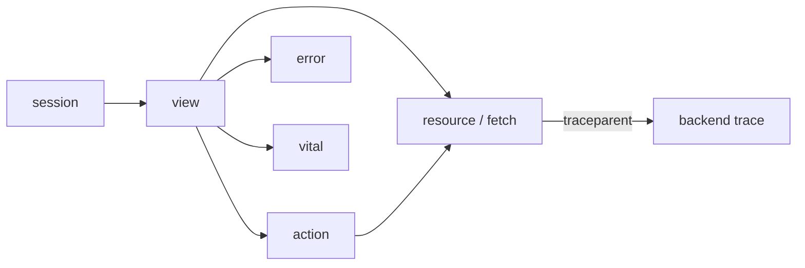

# libo11y RUM

This document is the charter of libo11y RUM and the human-readable form of
its conventions. The conventions are part of the specification from spec
1.1.0 on, and spec 1.3.0 adds the view summary. They live in the
registry under [`spec/registry`](../spec/registry). Where this document and
the registry disagree, the registry wins. Every RUM group has development
stability. The RUM libraries themselves arrive in later releases, starting
with `@libo11y/rum` in `ts/v0.3.0`.

## Charter

RUM is libo11y's second product. libo11y core wraps OpenTelemetry setup,
and it writes instrumentation only where OpenTelemetry has none to wrap.
RUM is an opinionated real-user-monitoring data model.
It emits pure OTLP through the standard OpenTelemetry API, so any OTLP
backend can store what it records. Its conventions are part of the libo11y
specification. Every RUM platform follows them.

RUM is private by default. Every feature can be switched on or off and
tuned in code. RUM uses upstream instrumentation, such as
`opentelemetry-js-contrib`, where that instrumentation is good. RUM
implements everything that upstream instrumentation does not cover.

## Products and platforms

Core and RUM are products. Each product has one implementation per
platform, and every implementation follows the one specification. Mobile is
a set of new platforms under both products, not a third product.

| Product | Go | Bun and Node | Browser | MV3 extension | React Native | iOS (Swift) | Android (Kotlin) |
|---|---|---|---|---|---|---|---|
| Core (setup) | `go` | `@libo11y/server` | `@libo11y/web` | `@libo11y/webext` | `@libo11y/react-native` | `Libo11y` Swift package | `libo11y-android` |
| RUM (experience) | gateway `go/o11yrum` | none | `@libo11y/rum` | `@libo11y/rum` | `@libo11y/rum-react-native` | `Libo11yRUM` | `libo11y-rum-android` |

Five cells exist today: the Go core (`go`), the Bun and Node core
(`@libo11y/server`), the browser core (`@libo11y/web`), the MV3
extension core (`@libo11y/webext`) and the RUM gateway (`go/o11yrum`).
The two browser cores first ship in `ts/v0.2.1`. The gateway first ships
in `go/o11yrum/v0.1.0`, with the `ghcr.io/jamesainslie/o11yrum-gateway`
image, and [its README](../go/o11yrum/README.md) covers configuration and
deployment. The browser RUM cell, `@libo11y/rum`, is in development in
`ts/packages/rum` and has not shipped. Its adapters for React
(`@libo11y/rum-react`), TanStack Router (`@libo11y/rum-tanstack-router`)
and Connect (`@libo11y/rum-connect`) are in development beside it, and so
is session replay (`@libo11y/rum-replay`), whose privacy core masks all
text by default and never records input values. Every other named cell is
planned.

## Data model

RUM records six kinds of thing: sessions, views, actions, resources,
errors and vitals.



A session holds views. A view is a page or route on the web and a screen on
mobile. A view holds actions, resources, errors and vitals. An action is a
user interaction, and it links to the requests and the route change it
caused. A resource is a request the view made, and it carries
`traceparent` to the backend so the backend trace joins the view. Every
RUM span and event carries `session.id`. Every span shape and the error,
frustration and view summary events also carry `o11y.rum.view.id`, and the
session start and end events do not. With those two attributes the gateway
and the planned Grafana session explorer can rebuild the timeline of a session.
Metrics carry neither attribute, because both are unbounded. The registry
defines span shapes for views, actions and app loads. It defines none for
resources yet.

## Conventions

Every name libo11y RUM mints is under `o11y.rum.*`. RUM references the
upstream semconv attributes it uses, such as `session.id`, and never
redefines them. The generator turns the conventions into typed keys and
enums in Go (`go/spec`, for example the key `spec.RUMViewNameKey` and the
enum type `spec.RUMViewKind`) and in TypeScript (`@libo11y/spec`, for
example `ATTR_RUM_VIEW_NAME`).

### Attributes

The platform-neutral attributes are in the group `registry.o11y.rum` in
[`spec/registry/attributes/rum.yaml`](../spec/registry/attributes/rum.yaml).
Every RUM platform uses them.

| Attribute | Type | Sensitivity | Cardinality | Allowed values |
|---|---|---|---|---|
| `o11y.rum.platform` | string | public | enum | `web`, `webext`, `react_native`, `ios`, `android` |
| `o11y.rum.view.name` | string | public | bounded | the route template on the web (never the raw URL), the screen name on mobile |
| `o11y.rum.view.id` | string | internal | unbounded | a random ID for one view instance in a session |
| `o11y.rum.view.kind` | string | public | enum | `initial`, `soft`, `bfcache_restore`, `prerender`, `screen` |
| `o11y.rum.action.type` | string | public | enum | `click`, `tap`, `long_press`, `swipe`, `scroll`, `submit`, `key_press`, `custom` |
| `o11y.rum.action.name` | string | internal | bounded | the element's `data-o11y` label or a privacy-safe accessible name, never text the user typed |
| `o11y.rum.frustration.type` | string | public | enum | `rage`, `dead`, `error` |
| `o11y.rum.error.source` | string | public | enum | `uncaught`, `unhandled_rejection`, `console`, `boundary`, `resource`, `csp`, `network`, `crash`, `anr`, `hang`, `custom` |
| `o11y.rum.error.fingerprint` | string | internal | bounded | a stable grouping key computed after symbolication |
| `o11y.rum.element.selector` | string | internal | unbounded | the selector or view identifier of the UI element |
| `o11y.rum.element.text` | string | pii | unbounded | the visible text of the UI element |
| `o11y.rum.device.class` | string | public | enum | `desktop`, `mobile`, `tablet`, `tv`, `bot`, `unknown` |
| `o11y.rum.connection.type` | string | public | enum | `wifi`, `cellular`, `ethernet`, `offline`, `unknown` |
| `o11y.rum.connection.effective` | string | public | enum | `slow-2g`, `2g`, `3g`, `4g` |
| `o11y.rum.vital.rating` | string | public | enum | `good`, `needs-improvement`, `poor` |
| `o11y.rum.session.retained` | string | public | enum | `head_sampled`, `error`, `frustration` |
| `o11y.rum.replay.segment` | int | public | unbounded | the index of the replay segment in the session |
| `o11y.rum.config.version` | string | public | bounded | the version of the remote configuration the session ran under |
| `o11y.rum.span.shape` | string | public | enum | `view`, `action`, `app_load`: the span shape a span follows (spec 1.3.0) |
| `o11y.rum.app.update_id` | string | public | bounded | the over-the-air update a mobile app runs, such as an Expo Updates update ID, absent for the embedded bundle (spec 1.3.0) |

The view summary group `registry.o11y.rum.summary`, in
[`spec/registry/attributes/rum-summary.yaml`](../spec/registry/attributes/rum-summary.yaml),
holds the attributes of the `o11y.rum.view.summary` event (spec 1.3.0).
Every one is public and unbounded, so none may be a metric label. Counts
and time on view are deltas since the previous summary of the same view,
and an absent count means zero.

| Attribute | Type | Meaning |
|---|---|---|
| `o11y.rum.summary.seq` | int | the 0-based index of the summary within its view |
| `o11y.rum.summary.time_on_view` | double | seconds the view was visible |
| `o11y.rum.summary.requests` | int | requests the view started |
| `o11y.rum.summary.long_animation_frames` | int | long animation frames on the view |
| `o11y.rum.summary.errors.<source>` | int | errors from one `o11y.rum.error.source` value, one attribute per value |
| `o11y.rum.summary.frustrations.<type>` | int | frustration signals of one `o11y.rum.frustration.type` value, one attribute per value |
| `o11y.rum.summary.<vital>.value` | double | the value of `lcp`, `inp`, `fcp` or `ttfb` in seconds, or of `cls` with no unit |

The rule `libo11y_rum_summary_coverage` fails `make spec-check` when an
`o11y.rum.error.source` or `o11y.rum.frustration.type` value has no count,
or when a count names a value the enum does not have.

The browser group `registry.o11y.rum.browser` holds the attributes RUM
records only in browsers and browser extensions.

| Attribute | Type | Sensitivity | Cardinality | Allowed values |
|---|---|---|---|---|
| `o11y.rum.browser.family` | string | public | bounded | the browser family the gateway parsed from the user agent, such as `chrome`, `firefox`, `safari`, `edge` or `other` |

The detail group `registry.o11y.rum.detail`, in
[`spec/registry/attributes/rum-detail.yaml`](../spec/registry/attributes/rum-detail.yaml),
holds what kept sessions send beyond the view summary (spec 1.3.0).
Breadcrumbs ride on `o11y.rum.error`. Vital attribution rides on the
semconv event `browser.web_vital`, which in semconv 1.41.0 carries only
the vital's name, value, delta and ID. Resource and Server-Timing
attributes ride on resource spans. Durations are in seconds.

| Attribute | Type | Sensitivity | Cardinality | Meaning |
|---|---|---|---|---|
| `o11y.rum.error.breadcrumbs` | string | internal | unbounded | the actions, view changes and requests before an error, oldest first, one per line as `<kind> <label> -<age>ms`. A request label is the method, host and status, never a path |
| `o11y.rum.vital.attribution.input_delay`, `.processing_duration`, `.presentation_delay` | double | public | unbounded | INP attribution |
| `o11y.rum.vital.attribution.interaction_type` | string | public | enum | INP attribution: `pointer` or `keyboard` |
| `o11y.rum.vital.attribution.time_to_first_byte`, `.resource_load_delay`, `.resource_load_duration`, `.element_render_delay` | double | public | unbounded | LCP attribution |
| `o11y.rum.vital.attribution.largest_shift_value`, `.largest_shift_time` | double | public | unbounded | CLS attribution |
| `o11y.rum.vital.attribution.load_state` | string | public | enum | INP and CLS attribution: `loading`, `dom-interactive`, `dom-content-loaded`, `complete` |
| `o11y.rum.resource.type` | string | public | enum | `script`, `stylesheet`, `image`, `font`, `media`, `document`, `other` |
| `o11y.rum.server_timing.name` | string | public | bounded | the metric name of one Server-Timing entry on a resource's response |
| `o11y.rum.server_timing.duration` | double | public | unbounded | the duration of that entry |

The group `libo11y.rum.upstream` classifies the upstream attributes RUM
uses.

| Attribute | Sensitivity | Cardinality |
|---|---|---|
| `session.id` | internal | unbounded |
| `geo.country.iso_code` | public | bounded |
| `os.name` | public | bounded |

### Span shapes

RUM records three span shapes. Each shape is a group named
`libo11y.rum.span.<shape>` in
[`spec/registry/spans/rum.yaml`](../spec/registry/spans/rum.yaml). The
group's `o11y.rum.span` annotation names the shape. It must be `view`,
`action` or `app_load`, and it must equal the suffix of the group ID.
`make spec-check` enforces both with the rule `libo11y_rum_span_kind`. The
generator writes the required attributes of each shape to
`RUMSpanRequired` in Go and `RUM_SPAN_REQUIRED` in TypeScript. The Go table
is in the internal package `go/internal/spectables`, which the library and
its test harness use and applications cannot import. The TypeScript table
is exported from `@libo11y/spec`.

| Shape | Records | Required attributes | Conditionally required |
|---|---|---|---|
| `view` | each view | `o11y.rum.span.shape`, `o11y.rum.platform`, `o11y.rum.view.name`, `o11y.rum.view.id`, `o11y.rum.view.kind`, `session.id` | none |
| `action` | each user action | `o11y.rum.span.shape`, `o11y.rum.action.type`, `o11y.rum.view.id`, `session.id` | `o11y.rum.action.name`, when the element has a `data-o11y` label or a privacy-safe accessible name |
| `app_load` | the document load on the web, the app start on mobile | `o11y.rum.span.shape`, `o11y.rum.platform`, `o11y.rum.view.id`, `session.id` | none |

Spec 1.3.0 fixes when the view and action spans start and end.

| Shape | Starts | Ends |
|---|---|---|
| `view`, initial | as a child of `app_load` | at the first paint after the routed view renders |
| `view`, soft navigation | as a root span, at the route change | at the first paint after the new route renders, capped at 10 seconds |
| `action` | at the user interaction | once its requests have finished and the page has been idle for 100 ms, capped at 10 seconds |

A view span covers getting into the view, and the view summary carries the
time spent on it. The requests an action caused are children of its span.
The action span links to the view it happened on, and a view the action
caused links back to it.

An action span ends at the time of its last activity: its start, the end
of a request it caused, or a DOM change. The client detects the end once
no request is pending and 100 ms passed without activity, so the idle wait
is not part of the duration. A new action ends the open one at once.

Clients name the spans `view <o11y.rum.view.name>`, `action
<o11y.rum.action.type>` and `app_load`. The name is for people reading a
trace. The gateway identifies a shape by `o11y.rum.span.shape`, never by
the name, so every RUM span shape must set that attribute. The action name
never goes in the span name, because span names bypass the sensitivity
policy. On the web, `@libo11y/rum` turns the `documentLoad` span of
`@libo11y/web` into the `app_load` shape.

Resource spans are not a shape. The web client names them `resource
<o11y.rum.resource.type>` and gives each one `o11y.rum.resource.type`,
`url.full`, `server.address`, `session.id` and `o11y.rum.view.id`. Each
Server-Timing entry other than `traceparent` is a `server_timing` span
event with `o11y.rum.server_timing.name` and
`o11y.rum.server_timing.duration`. A `traceparent` entry is a link to the
server span.

### Session sampling

A session's detail is sent from its start when the session is
head-sampled. Every client decides it the same way from the session ID, so
every tab of a session and every client language agree:

```
sampled = fnv1a32(utf8(session.id)) / 2^32 < sessionSampleRate
```

`fnv1a32` is FNV-1a over 32 bits: offset basis `0x811c9dc5`, prime
`0x01000193`, over the UTF-8 bytes of the ID, as an unsigned integer. A
rate at or below 0, or NaN, keeps nothing. A rate at or above 1 keeps
everything.

A session that is not head-sampled still sends a view summary for every
view. Its other records wait in a retention buffer, bounded by bytes and
age. An error or a frustration signal keeps the session from then on, and
the buffered records are sent. A session that ends without being kept
drops its buffer.

### The gateway wire contract

Every OTLP request a RUM client sends to the gateway carries two query
parameters, because `sendBeacon` cannot set headers:
- `sent_at`: the client's Unix time in milliseconds when the request was
  sent. Each retry carries its own.
- `client_token`: the app's public client token. It identifies the app and
  is not a secret.

App metrics from the Meter API export with delta temporality. The gateway
accepts only delta sums and delta explicit-bucket histograms.

When several tabs of a session find it expired at the same moment, each
ends it and starts a session of its own, and then all of them adopt the
newest one. Only the tab whose new session won sends
`o11y.rum.session.end`. A session that ends without being kept removes
only its own records from the shared retention buffer.

### Remote configuration

A client fetches its remote configuration with
`GET /_o11y/v1/config?service=<service.name>`, plus `client_token`, after
consent is granted and without credentials. The gateway answers
`{"version": "<16 hex>", "config": {...}}` with the version as the ETag,
`304` to a matching `If-None-Match`, and `404` when the app has none.
The gateway does not read the document. Clients own the keys inside
`config` and ignore keys they do not know:

| Key | Type | Meaning |
|---|---|---|
| `enabled` | boolean | `false` is a kill switch: the client stops recording at once, and `true` starts it again |
| `sessionSampleRate` | number, 0 to 1 | the head-sampling rate of new sessions, kept within the range the app's code allows (by default no change) |
| `collectors` | object of booleans | `false` switches off a collector the app installed; `true` never adds one |

A document applies to the next session, never to the running one, except
for `enabled: false`. Each session records the version it started under
as `o11y.rum.config.version` on `o11y.rum.session.start` and on its view
summaries. Remote configuration can never lower masking.

### Metrics

The platform-neutral metrics are in
[`spec/registry/metrics/rum.yaml`](../spec/registry/metrics/rum.yaml). The
browser metrics are in
[`spec/registry/metrics/rum-browser.yaml`](../spec/registry/metrics/rum-browser.yaml).
Every label is bounded or an enum. Labels in bold are required. The
gateway sets `service.name` to the app that sent the summary, because one
gateway serves many apps. The
gateway derives every one of these metrics from `o11y.rum.view.summary`
events, and clients do not export them. SPEC.md section 6 gives the
mapping from summary attributes to metrics and the thresholds the gateway
uses for `o11y.rum.vital.rating`. Go has a
name constant for each metric, such as `spec.MetricRUMVitalLCP`, and
TypeScript has one such as `METRIC_RUM_VITAL_LCP`.

| Metric | Instrument | Unit | Labels |
|---|---|---|---|
| `o11y.rum.views` | counter | `{view}` | **`service.name`**, **`o11y.rum.platform`**, **`o11y.rum.view.name`**, `o11y.rum.view.kind`, `o11y.rum.device.class` |
| `o11y.rum.errors` | counter | `{error}` | **`service.name`**, **`o11y.rum.platform`**, `o11y.rum.view.name`, **`o11y.rum.error.source`** |
| `o11y.rum.frustrations` | counter | `{signal}` | **`service.name`**, **`o11y.rum.platform`**, `o11y.rum.view.name`, **`o11y.rum.frustration.type`** |
| `o11y.rum.vital.lcp` | histogram | `s` | the vital labels below |
| `o11y.rum.vital.inp` | histogram | `s` | the vital labels below |
| `o11y.rum.vital.cls` | histogram | `1` | the vital labels below |
| `o11y.rum.vital.fcp` | histogram | `s` | the vital labels below |
| `o11y.rum.vital.ttfb` | histogram | `s` | the vital labels below |
| `o11y.rum.browser.long_animation_frames` | counter | `{frame}` | **`service.name`**, **`o11y.rum.view.name`** |

The five web vitals share one label set. `service.name` and
`o11y.rum.view.name` are required.
The others are `o11y.rum.vital.rating`, `o11y.rum.device.class`,
`o11y.rum.browser.family`, `o11y.rum.connection.effective` and
`geo.country.iso_code`. LCP, INP, FCP and TTFB are durations in seconds.
CLS is a unitless score.

### Events

The RUM events are in
[`spec/registry/logs/events.yaml`](../spec/registry/logs/events.yaml),
next to the core events. RUM also emits the semconv event
`browser.web_vital` as upstream defines it. That event belongs to semconv,
so the registry does not register it.

Semconv 1.41.0 puts the fields of `browser.web_vital` in the log record's
body: the vital's `name`, `value`, `delta` and `id`. RUM sends `name` in
lowercase (`lcp`, `inp`, `cls`, `fcp`, `ttfb`) and `value` and `delta` in
the spec's units: seconds, and no unit for CLS. Its attributes are
`session.id`, `o11y.rum.view.id` of the view that loaded the page, the
`o11y.rum.vital.attribution.*` keys of `registry.o11y.rum.detail`, and
`o11y.rum.element.selector`. It never carries a rating. Only kept
sessions send it.

| Event | Records | Required attributes | Optional attributes |
|---|---|---|---|
| `o11y.rum.error` | an error RUM captured | `o11y.rum.error.source`, `exception.type`, `session.id`, `o11y.rum.view.id` | `o11y.rum.error.fingerprint`, `o11y.rum.error.breadcrumbs` |
| `o11y.rum.frustration` | a frustration signal on a UI element | `o11y.rum.frustration.type`, `session.id`, `o11y.rum.view.id` | `o11y.rum.element.selector` |
| `o11y.rum.session.start` | the start of a session | `session.id`, `o11y.rum.platform` | none |
| `o11y.rum.session.end` | the end of a session | `session.id`, `o11y.rum.session.retained` | none |
| `o11y.rum.view.summary` | a view's counts, time on view and vitals since its previous summary (spec 1.3.0) | `o11y.rum.platform`, `o11y.rum.view.id`, `o11y.rum.view.name`, `o11y.rum.view.kind`, `session.id`, `o11y.rum.summary.seq`, `o11y.rum.summary.time_on_view` | `o11y.rum.device.class`, `o11y.rum.connection.effective`, `o11y.rum.config.version`, and the counts and vital values of `registry.o11y.rum.summary` |

## Growing the conventions

The centre of the conventions is platform-neutral, and its enums already
cover mobile, such as screens, taps, crashes and ANRs. A new platform adds
enum values to a centre attribute, or it adds a platform group of its own.
The browser group `registry.o11y.rum.browser` is the first platform group.
The mobile steps will add mobile vitals as further `o11y.rum.vital.*`
histograms. A new platform never renames a centre attribute.

A rename from 1.0.0 on needs a transform in the schema file, so that
consumers of older versions can translate the old name. The generator
cannot render transforms yet. Until it can, `make spec-check` refuses such
a rename with the rule `libo11y_rename_needs_transform`. A new span shape
needs a change to the spec checker too, because `libo11y_rum_span_kind`
accepts only `view`, `action` and `app_load`.

## Privacy

`o11y.rum.element.text` is classified `pii`, because UI text can show
names, addresses and other personal data. The sensitivity policy therefore
drops it in the default PII mode, `drop`. RUM never records form values. No RUM
attribute carries one, and `o11y.rum.action.name` never holds text the
user typed.

`session.id` is classified `internal`. So are the view ID, the action name,
the error fingerprint and the element selector. The sensitivity policy
passes internal attributes in every PII mode.

See [SPEC.md](SPEC.md), section 5, for the sensitivity classes and the PII
modes.
