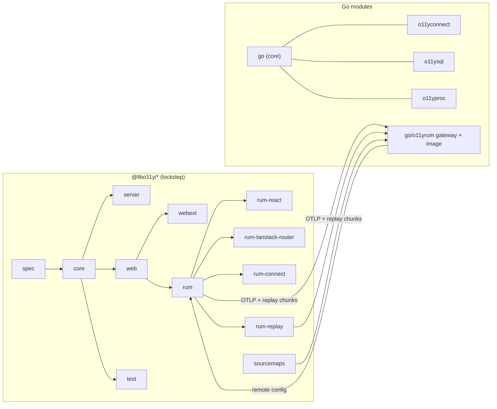
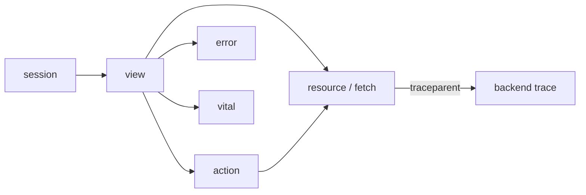

# The libo11y family: core, RUM, and the TypeScript implementation

Date: 2026-11-18. Status: approved by the owner in brainstorming.

## Goal

libo11y today is one product with one implementation: Go, released as `go/v0.1.0`, which wraps OpenTelemetry setup. The owner wants libo11y to be a world-class observability family that the Life of Reily (LOR) platform can adopt end to end. LOR has Go services, a Bun server, two browser applications and a Manifest V3 browser extension. This document designs the family. It covers the two products and their charters, the components in each language, the specification additions they share, the release model and the quality bars. Each delivery step below gets its own detailed spec when it starts.

The LOR adoption program is specified separately, in the lor-client-portal repository at `docs/design/2026-11-18-lor-observability-design.md`. libo11y releases come first. LOR changes start only after the releases they depend on are published.

## Where things stand

- `go/` implements the design contract: `Setup` and `New`, strict identity, the slog pipeline, sensitivity classification, exemplars, events and wide events, `o11yhttp`, `o11ygrpc`, the separate `o11ygin` module and the `o11ytest` harness.
- `spec/` is the versioned registry (`spec/v1.0.0`). `make spec-check` validates it, and `internal/specgen` generates Go code from it.
- `rust/`, `java/` and `zig/` hold only READMEs.
- There is no TypeScript implementation and no browser support.
- The spec has no way for an application to classify its own attributes. Application keys are unclassified, so the sensitivity layer never protects them.

## Decisions

- **D1. Two products in one family.** libo11y core keeps its charter, which is to wrap setup and never instrumentation. libo11y RUM is a second product with its own charter, written down in `docs/RUM.md`. Both share one specification, one repository and one release discipline.
- **D2. The RUM charter.** RUM is an opinionated real-user-monitoring data model. It emits pure OTLP through the standard OpenTelemetry API, so any OTLP backend can store it. Its conventions live in the libo11y specification. It is private by default and every feature can be configured. It uses upstream `opentelemetry-js-contrib` instrumentation where that instrumentation is good, and owns the rest.
- **D3. Features first.** The owner chose the most capable feature set over the smallest bundle. Size is managed by lazy loading and reported per feature, and no feature is cut to meet a size target.
- **D4. Built on the upstream OpenTelemetry JS SDK.** All three signals use the official SDK packages, so upstream samplers, processors, views, exporters and contrib instrumentations work unchanged. libo11y adds configuration, policy and features on top. It does not reimplement the SDK.
- **D5. Pluggable browser context.** The default browser context manager is libo11y's own. It carries context across `fetch`, timers, promise continuations and event listeners. zone.js is an opt-in, because it cannot follow native `async`/`await`.
- **D6. A logger of its own.** JavaScript has no structured logging facade comparable to slog. libo11y TS exports one small structured logger built on the OpenTelemetry Logs API. It can also capture `console.*`, so stray calls still arrive.
- **D7. npm org `@libo11y`, lockstep versions.** Every TypeScript package publishes under the `@libo11y` npm organisation at one shared version. A `ts/vX.Y.Z` tag triggers the release, which uses changesets and npm provenance. The org name is checked for availability before it is created.
- **D8. An application attribute registry.** A consumer can declare its own namespaced attributes with sensitivity, type and cardinality. Both languages load the registry at setup and classify those keys exactly like spec keys.
- **D9. The gateway is part of RUM.** Browser telemetry needs a receiving service for validation, limits, enrichment, symbolication and remote configuration. libo11y ships it as a Go module, `go/o11yrum`, and as a container image.
- **D10. Replay is included and fully configurable.** Session replay is a separate package, installed only by apps that want it. Its default masks all text and all inputs.
- **D11. A session explorer dashboard first, an app plugin later.** `ops/v0.1.0` ships the session explorer as a Grafana dashboard. It takes a `session.id` and an optional `o11y.rum.view.id` and shows that session's views, events, traces and spans from Loki and Tempo, with no plugin to sign or install. Grafana cannot play rrweb recordings or list sessions from a dashboard, so a Grafana app plugin with a session list and a replay player follows in a later `ops` release, after replay (L7) lands.
- **D12. Products and platforms are separate axes.** Core and RUM are products. Each product has one implementation per platform, and every implementation follows the one spec. Core's TypeScript implementation is `@libo11y/core`, which is platform-neutral, plus a platform layer per runtime (`server`, `web`, `webext`, `react-native`). RUM sits on top of a platform layer. Mobile is a set of new platforms under both products, not a third product.
- **D13. Mobile on three stacks.** The owner needs Expo/React Native, native iOS (Swift) and native Android (Kotlin). React Native reuses `@libo11y/core` and the platform-neutral half of RUM in TypeScript, with a thin native module that delegates to the Swift and Kotlin libraries for crashes, app start, frames and ANRs. Swift and Kotlin get full implementations of core and RUM on opentelemetry-swift and opentelemetry-android, and the spec gains Swift and Kotlin codegen targets. Every RUM platform shares the data model, the gateway and the Grafana session explorer.
- **D14. Platform-neutral RUM conventions.** Session, view, action, error, resource, frustration and retention conventions are generic, and their enums cover mobile from the start (screens, taps, swipes, crashes, ANRs). Platform-only conventions live in their own groups, such as the browser family, so a new platform adds groups and never renames existing ones.

## Products and platforms

| Product | Go | Bun and Node | Browser | MV3 extension | React Native | iOS (Swift) | Android (Kotlin) |
|---|---|---|---|---|---|---|---|
| Core (setup) | `go` | `@libo11y/server` | `@libo11y/web` | `@libo11y/webext` | `@libo11y/react-native` | `Libo11y` Swift package | `libo11y-android` |
| RUM (experience) | gateway `go/o11yrum` | none | `@libo11y/rum` | `@libo11y/rum` | `@libo11y/rum-react-native` | `Libo11yRUM` | `libo11y-rum-android` |

## Components



### TypeScript packages

| Package | Product | Purpose | Runs in |
|---|---|---|---|
| `@libo11y/spec` | shared | Generated attribute keys, enums, event names and sensitivity tables, plus the application registry loader and validator. No runtime dependencies. | everywhere |
| `@libo11y/core` | core | Configuration resolution, identity, the sensitivity policy, the logger, events and force-emit, the startup canary, the lifecycle handle and the trace-based exemplar reservoir. Platform-neutral. | everywhere |
| `@libo11y/server` | core | `setup()` for Bun and Node: `AsyncLocalStorage` context, resource detectors (host, process, container, Kubernetes Downward API), OTLP exporters, `instrumentServe` for fetch-style handlers, an instrumented `fetch`, and `Server-Timing` traceparent on HTML responses. | Bun, Node |
| `@libo11y/web` | core | `setup()` for browsers: the pluggable context manager, the browser resource, the OTLP/HTTP JSON transport, the consent gate and `fetch`/XHR propagation. No RUM features. | browsers |
| `@libo11y/webext` | core | The Manifest V3 platform: service worker lifecycle (termination at any time, no DOM, no beacons), content-script context and messaging between them. | extensions |
| `@libo11y/rum` | RUM | The RUM data model and its collectors (see [RUM](#rum)). | browsers, extensions |
| `@libo11y/rum-react` | RUM | Error boundary, component render timings and interaction naming hooks. | React apps |
| `@libo11y/rum-tanstack-router` | RUM | View naming by route template and soft-navigation timing. | TanStack Router apps |
| `@libo11y/rum-connect` | RUM | Connect RPC naming for browser `fetch` spans, using `rpc.*` attributes. | Connect clients |
| `@libo11y/rum-replay` | RUM | rrweb-based session replay with configurable masking. | browsers |
| `@libo11y/test` | shared | In-memory recorder, conformance assertions and a fake OTLP sink, for Bun, Node and Playwright. | tests |
| `@libo11y/sourcemaps` | RUM | Build-time CLI and library that upload source maps to the gateway and keep them out of the public bundle. | build |

### Go modules

| Module or package | Product | Purpose |
|---|---|---|
| `go` (existing) | core | Gains the application registry (`WithAppRegistry`), and the `o11yproc` package and detached-work helpers described below. |
| `go/o11yconnect` | core | Connect server and client interceptors built on `connectrpc.com/otelconnect`, with libo11y defaults. A separate module, so core users never download Connect. |
| `go/o11ysql` | core | `database/sql` driver wrapper with semconv `db.*` spans and metrics. A separate module. |
| `go/o11yrum` | RUM | The RUM gateway as an `http.Handler`, plus `cmd/o11yrum-gateway` for the container image. A separate module, so its user-agent and source-map dependencies stay out of core. |

## Specification additions (step L1)

### TypeScript codegen

`internal/specgen` gains a TypeScript target that writes `ts/packages/spec/src/generated/`. It emits typed key constants, closed enums as string-literal unions with runtime arrays, event names and the sensitivity, type and cardinality tables. `make spec-check` gains a drift gate that fails when the generated TypeScript differs from the registry, matching the Go gate.

### Application attribute registry

A consumer keeps a file such as `o11y-registry.yaml`:

```yaml
schema: libo11y.app-registry/v1
namespace: lor
attributes:
  lor.user.id:      {type: string, sensitivity: internal, cardinality: unbounded}
  lor.user.role:    {type: string, sensitivity: public, cardinality: enum, values: [studio, client]}
  lor.project.id:   {type: string, sensitivity: internal, cardinality: unbounded}
  lor.client.email: {type: string, sensitivity: pii}
```

The validator applies the existing spec-check rules for naming, sensitivity, cardinality and enums. It refuses any key outside the declared namespace, and it refuses the `otel.*`, `o11y.*` and semconv-owned namespaces. Go loads the file with `WithAppRegistry(fs.FS, path)` and TypeScript with `setup({ registry })`. TypeScript can also take a registry compiled at build time, so browsers never fetch YAML. The sensitivity policy then treats registered application keys exactly like spec keys. A key that is registered `pii` is dropped or hashed according to the PII mode, and a key that is registered `internal` passes. The `libo11y registry check <file>` command validates a registry in a consumer's CI. It ships as a Go binary and as a bin in `@libo11y/spec`.

### RUM conventions

The registry gains development-stability RUM groups. The spec's ownership rules let libo11y mint names only under `o11y.*`, so every RUM name is `o11y.rum.*`. The RUM groups reference semconv's `session.id` and `browser.*` attributes and never redefine them. RUM also emits semconv's `browser.web_vital` event as upstream defines it. It defines:

The conventions have a platform-neutral centre that every RUM platform uses (D14):

- span shapes: the view span, the action span and the app-load span (the document load on the web, the app start on mobile), each with its required attributes
- attributes: `o11y.rum.platform` (web, webext, react_native, ios, android), `o11y.rum.view.name` (the route template or screen name), `o11y.rum.view.id`, `o11y.rum.view.kind` (initial, soft, bfcache_restore, prerender, screen), `o11y.rum.action.type` (click, tap, long_press, swipe, scroll, submit, key_press, custom) and `o11y.rum.action.name`, `o11y.rum.frustration.type` (rage, dead, error), `o11y.rum.error.source` (uncaught, unhandled_rejection, console, boundary, resource, csp, network, crash, anr, hang, custom) and `o11y.rum.error.fingerprint`, `o11y.rum.element.selector` and `o11y.rum.element.text`, `o11y.rum.device.class`, `o11y.rum.connection.type` (wifi, cellular, ethernet, offline, unknown) and `o11y.rum.connection.effective` (slow_2g, 2g, 3g, 4g), `o11y.rum.vital.rating`, `o11y.rum.session.retained`, `o11y.rum.replay.segment` and `o11y.rum.config.version`
- metrics: `o11y.rum.views`, `o11y.rum.errors` and `o11y.rum.frustrations`, each with bounded labels only
- events: `o11y.rum.error`, `o11y.rum.frustration`, `o11y.rum.session.start` and `o11y.rum.session.end`
- sensitivity: `session.id`, the view ID and the element selector are `internal`. `o11y.rum.element.text` is `pii`. libo11y RUM never records form values.

Platform groups sit at the edges. L1 adds the browser group: `o11y.rum.browser.family`, one histogram per web vital (`o11y.rum.vital.lcp`, `o11y.rum.vital.inp`, `o11y.rum.vital.cls`, `o11y.rum.vital.fcp`, `o11y.rum.vital.ttfb`) and `o11y.rum.browser.long_animation_frames`. The mobile steps add a mobile group: app start, frozen and slow frames, and hangs as `o11y.rum.vital.*` histograms, plus OS and app-version context.

The spec version becomes `spec/v1.1.0`. The manifest gains a version history, so the generator renders a schema file for every released version, and the 1.0.0 file stays byte for byte as published.

## Go additions (step L2, release `go/v0.2.0`)

- **`o11yconnect`.** `ServerInterceptor(opts...)` and `ClientInterceptor(opts...)`. The options are `WithSDK`, `WithPublicEndpoint` (link instead of adopt), `WithIgnoreHealthChecks` and `WithCanonicalLine`. Spans and metrics follow `rpc.*` with `rpc.system=connect_rpc`, matching `o11ygrpc`.
- **`o11ysql`.** `o11ysql.Open(driverName, dsn, opts...)` and `o11ysql.Wrap(driver.Connector)`. Spans use `db.system.name`, `db.operation.name`, `db.collection.name` when known, and `db.query.text` with literals replaced by `?`. The text can be turned off. A span is created only when there is a parent, so background pings never make root spans. Metrics are `db.client.operation.duration` and the connection pool gauges.
- **Detached work.** `o11y.Capture(ctx) Carrier` returns a small serialisable value (traceparent, tracestate and filtered baggage) that implements `encoding.TextMarshaler` and `sql.Scanner`. `o11y.StartLinked(ctx, carrier, name, opts...)` starts a new root span with a link to the captured context. Jobs, queued email and message consumers store the carrier with the work.
- **`o11yproc`.** `o11yproc.Env(ctx) []string` returns `TRACEPARENT` and `TRACESTATE` entries for a child process, and `o11yproc.FromEnv(ctx)` adopts them in the child. For framed socket protocols, the package documents the convention of a `traceparent` header in the frame and gives `Inject` and `Extract` helpers over a `map[string]string`.

## TypeScript foundation (step L3, release `ts/v0.1.0`)

The packages are `spec`, `core`, `server` and `test`. The API follows the Go shape in TypeScript idiom.

```ts
import { setup } from "@libo11y/server";

const telemetry = await setup({
  serviceName: "lor-site",
  environment: "production",
  registry: appRegistry,
  captureConsole: true,
});
telemetry.logger.info("ready", { "lor.site.build": build });
process.on("SIGTERM", () => telemetry.shutdown());
```

- `setup()` refuses a missing or invalid service name or environment, as Go does, and has a non-strict option for migration and tests. It installs the global providers and propagators and emits the `o11y.telemetry.configured` canary. After a successful setup it never throws. `shutdown()` is idempotent and bounded by a 5 second default.
- Configuration precedence is the code option, then `OTEL_*` variables, then defaults. Environment parsing is delegated to the upstream SDK.
- The logger has `trace`, `debug`, `info`, `warn`, `error` and `fatal`, plus `child(attrs)`. Records read the active context, pass through the sensitivity layer and go to a JSON console line and the OTLP log pipeline. Console lines carry top-level `trace_id` and `span_id`. With `captureConsole`, `console.*` calls become log records marked `o11y.log.source=console`.
- `instrumentServe(handler, opts)` wraps any `(Request) => Response` handler, which covers `Bun.serve`, Node adapters and framework fetch handlers. It names server spans from a route resolver, records `http.server.request.duration` with exemplars, and adopts inbound context. With `publicEndpoint: true` it links instead. It can set `Server-Timing: traceparent;desc="..."` on HTML responses.
- The instrumented `fetch` creates client spans and injects context.
- Exemplars match Go. If the upstream metrics SDK lacks trace-based exemplars at implementation time, `core` supplies a trace-based exemplar reservoir, and the change is offered upstream.
- `@libo11y/test` gives `createRecorder()`, `assertConforms()`, triangle assertions (span, correlated log, exemplar on a duration point) and a fake OTLP HTTP sink.
- CI runs every package's suite on Bun and on Node LTS.

## Browser platforms (step L4, release `ts/v0.2.0`)

- **`web`.** `setup()` for browsers uses the upstream web tracer, meter and logger providers with libo11y's context manager. Resource attributes come from the browser (`browser.*`, `user_agent.original` only if allowed) and from the app. The transport sends OTLP/HTTP JSON, gzip-compressed through `CompressionStream` when available. It batches, flushes on `visibilitychange` to hidden with `sendBeacon` or `fetch` `keepalive`, retries offline from an IndexedDB queue with backoff, and honours 429 and `Retry-After`.
- **Consent.** `consent.grant()`, `consent.revoke()` and `consent.state()`. In the `pending` state nothing is recorded, nothing is buffered and nothing is sent. Revoking clears queues. The gate can be set to respect DNT and GPC.
- **Propagation.** `fetch` and XHR spans inject `traceparent` only for same-origin requests and an explicit origin allow-list. The document-load span adopts `Server-Timing: traceparent` from the navigation entry, which joins the first page load to its backend trace.
- **`webext`.** `setup()` for a Manifest V3 service worker persists its queue in IndexedDB on every batch, because the worker can be stopped at any time. Content scripts forward records to the worker by runtime messaging, and the context crosses with them.

## RUM (step L5, release `ts/v0.3.0`)

### Data model



A session holds views. A view holds actions, resources, errors and vitals. An action links to the requests and the route change it caused. Every record carries `session.id` and the view's span context, so the gateway and the Grafana plugin can rebuild the timeline.

### Feature catalog

| Area | Features |
|---|---|
| Sessions | Start and end, inactivity timeout and maximum length, sharing across tabs, consistent per-session head sampling, `identify()` with a pseudonymous ID, session attributes, and retroactive sampling: buffer a session and keep it whenever it hits an error or a frustration signal, even under a low base rate. |
| Views | Initial load and soft navigations named by route template through adapters, time on view, per-view counts of errors, long frames and requests, back/forward-cache restores, prerendered pages. |
| Performance | LCP, INP and CLS with attribution (the LCP element, the INP target and its phases, the largest layout-shift source), FCP and TTFB, navigation phases, resource timing with `Server-Timing` parsed, Long Animation Frames with script attribution and a long-task fallback, memory where the browser exposes it. |
| Backend join | Document load adopts `Server-Timing: traceparent`. `fetch` and XHR inject `traceparent` to allowed origins. `rum-connect` names spans as RPCs. |
| Interactions | Click, submit and key-press action spans named by `data-o11y` or a privacy-safe accessible name, linked to the requests and route change they caused. Rage, dead and error clicks. |
| Errors | Uncaught errors, unhandled rejections, optional `console.error`, the React error boundary, failed resource loads, CSP violations and network failures. Each error carries breadcrumbs (recent actions, navigations and requests), a fingerprint and the release version. The gateway resolves source maps. |
| Custom | Custom actions, timings and events. Feature-flag evaluation tracking through an OpenFeature hook, so errors and vitals can be split by flag. |
| Context | Device class, browser, OS, viewport, connection type, locale and visibility. The gateway adds the country. |
| Privacy | The consent gate, DNT and GPC, a URL query parameter allow-list, a text-capture policy, `data-o11y-mask`, and spec sensitivity classes on every attribute. |
| Delivery | The `web` or `webext` transport. A small bootstrap runs inline and buffers. The heavier collectors load after the `load` event and replay the buffer. |

### Configuration

Every collector and every feature can be switched on or off and tuned in code. Remote configuration lets the gateway serve sampling rates, collector switches, masking rules and replay triggers at runtime. Code sets the defaults and the hard limits. Remote configuration can change values only inside those limits, so it can never lower masking below the level the app declared, and it can never turn on a collector the app did not install. Each remote configuration has a version, and each session records the version it ran under.

## Replay (step L7)

`@libo11y/rum-replay` records DOM changes with rrweb and sends compressed segments to the gateway, which stores them in an object store and indexes them by session. Masking has three modes: mask all text and inputs (the default), mask inputs only, and an allow-list. Element rules use `data-o11y-mask` and `data-o11y-unmask`. Recording can be sampled per session, turned on only after an error, or limited to sessions that match a remote rule. Every segment records the view and the trace context active when it was recorded, so the player can jump from a moment in the replay to the trace behind it.

## Gateway (steps L6 and L7, `go/o11yrum`)

- **Ingest.** It accepts `POST /v1/traces`, `/v1/metrics` and `/v1/logs` as OTLP/HTTP JSON or protobuf, and `POST /v1/replay` for replay segments.
- **Validation and limits.** It checks the body size, and the service-name and origin allow-lists. It rate-limits per client. It drops resource keys that only a server may set.
- **Enrichment.** It parses the user agent into browser family, OS and device class. It adds the country from a trusted header that the operator names, never from the client. It discards client addresses.
- **Symbolication.** It resolves minified stack frames with uploaded source maps, keyed by release, and fingerprints errors after resolution.
- **Sinks.** The `Sink` interface receives the processed batch. The built-in sink exports OTLP to a collector. A consumer adds its own sinks. LOR adds a ClickHouse sink for its analytics views.
- **Remote configuration.** It serves `GET /v1/config` from a file or a provider interface, with ETag caching.
- **Source maps.** It accepts uploads on an authenticated endpoint and stores them outside public paths.
- **Delivery.** `o11yrum.NewHandler(opts...)` mounts in any Go server. `cmd/o11yrum-gateway` ships as a container image for operators who do not run Go.

## Ops pack (step L8, release `ops/v0.1.0`)

- `ops/v0.1.0` covers RUM: Grafana dashboards for the RUM overview, web vitals by view, device, browser and country, errors and frustration with the error inbox, the session explorer, and the gateway itself. Prometheus recording and alert rules cover vital regressions, error rate, gateway rejections, rate limiting, sink failures and latency, and the aggregator cap, shipped as rule files and as a `PrometheusRule`.
- `ops/v0.2.0` adds the core service dashboards (RED by route and RPC, dependencies by `peer.service`, runtime) and latency SLO burn-rate alerts, which need a name catalog from the core libraries.
- A later `ops` release adds the Grafana app plugin `libo11y-rum-app`. Its session explorer lists sessions, shows a session as one timeline (views, actions, requests, errors and joined backend traces and logs), and plays replay segments next to that timeline. It reads Tempo, Loki and Prometheus through Grafana's data sources and reads replay segments from the gateway. Operators can load it as a private plugin or sign it.

## Release model

- Go modules keep path-prefixed tags: `go/vX.Y.Z`, `go/o11yconnect/vX.Y.Z`, `go/o11ysql/vX.Y.Z`, `go/o11yrum/vX.Y.Z`. As with `o11ygin`, a submodule requires the parent at the same version.
- TypeScript packages release together from `ts/vX.Y.Z`, so every `@libo11y/*` package shares one version. A GitHub Actions workflow publishes them with npm provenance.
- The specification keeps `spec/vX.Y.Z`. The ops pack uses `ops/vX.Y.Z`, and its GitHub Release attaches `libo11y-ops-vX.Y.Z.tar.gz` (the dashboards, the rules and the kustomization) and `SHA256SUMS`. The plugin archive joins it once the plugin ships.
- `make release-check` covers every tag family.
- Each language and the ops pack has its own Keep a Changelog file.

## Quality bars

- TDD in each language's framework: `go test` for Go, `bun test` plus a Node run for TypeScript, and Playwright for the browser packages.
- An api-extractor report per TypeScript package. A change to the public API shows up as a report diff, which review must approve.
- A size report per package and per RUM collector in CI, with a recorded budget. A budget increase is a reviewed change, never a silent one.
- A browser support matrix tested on Chromium, Firefox and WebKit.
- An overhead benchmark that measures main-thread time added per view and per interaction, tracked across releases.
- No `eval` and no inline script generation, so the packages work under a strict CSP and with Trusted Types.
- A TypeScript column in `docs/PARITY.md`, with conformance tests that check the same contract in both languages.
- Runnable examples for Bun, Node, a React SPA, an extension and the gateway, plus a documentation site generated from the docs and API reports.

## Delivery

| Step | Contents | Release |
|---|---|---|
| L1 | Spec: TypeScript codegen, the application registry, RUM conventions, `docs/RUM.md` | `spec/v1.1.0` |
| L2 | Go: `o11yconnect`, `o11ysql`, detached work, `o11yproc`, `WithAppRegistry` | `go/v0.2.0` and submodules |
| L3 | TypeScript foundation: `spec`, `core`, `server`, `test` | `ts/v0.1.0` |
| L4 | Browser platforms: `web`, `webext` | `ts/v0.2.0` |
| L5 | RUM: `rum`, `rum-react`, `rum-tanstack-router`, `rum-connect`, remote config client | `ts/v0.3.0` |
| L6 | Gateway: `go/o11yrum`, the image, `@libo11y/sourcemaps` | `go/o11yrum/v0.1.0` |
| L7 | Replay: `rum-replay`, gateway replay storage | `ts/v0.4.0`, `go/o11yrum/v0.2.0` |
| L8 | Ops pack: RUM and gateway dashboards with a session explorer dashboard, rules; the app plugin follows | `ops/v0.1.0` |
| L9 | iOS: Swift codegen target, `Libo11y` (core) and `Libo11yRUM`, the mobile convention group, dSYM symbolication in the gateway | `swift/v0.1.0` |
| L10 | Android: Kotlin codegen target, `libo11y-android` (core) and `libo11y-rum-android`, R8/ProGuard symbolication in the gateway | `android/v0.1.0` |
| L11 | React Native: `@libo11y/react-native` and `@libo11y/rum-react-native`, an Expo config plugin, and a native module that delegates to L9 and L10 | a `ts/vX.Y.Z` release |

L1 comes first. L2 and L3 can run in parallel after it. L4 follows L3. L5 and L6 can run in parallel after L4. L7 follows L5 and L6. L8 follows L6 and can start its dashboards earlier. L9 and L10 can start after L6 and run in parallel. L11 follows L9 and L10.

## Out of scope

- Rust, Java and Zig implementations.
- A hosted backend. libo11y ships libraries, the gateway and the ops pack, and stores data only in the operator's own OTLP backends and object store.

## Risks

- Swift Package Manager resolves only plain semantic-version tags at the root of a package's repository, so the path-prefixed `swift/vX.Y.Z` tag cannot serve SwiftPM directly. L9's spec decides between a mirror repository that receives each Swift release and a CocoaPods-only distribution.
- Bun's `AsyncLocalStorage` has had gaps around some built-ins. L3 tests context propagation through Bun's `fetch`, timers, streams and `Bun.serve` before the API is fixed.
- Upstream OpenTelemetry JS may lack features libo11y needs, such as trace-based exemplars or a stable browser logs SDK. Each such gap is filled inside libo11y behind the upstream interfaces and offered upstream.
- rrweb's size and its effect on main-thread time are large. Replay loads lazily, and the overhead benchmark covers it.
- Remote configuration is a control channel into every browser. The gateway serves only configuration that its operator wrote, the client applies it only inside code-declared limits, and the config cannot turn on anything the app did not install.
