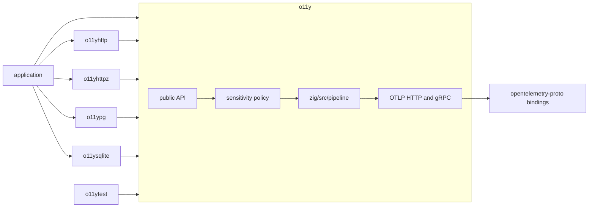

# libo11y Zig

Date: 2026-11-25. Status: approved by the owner in brainstorming.

## Goal

libo11y Zig implements the design contract in [DESIGN.md](../DESIGN.md) for Zig programs, at parity with the Go implementation wherever a Go capability applies to Zig. It is released as `zig/v0.1.0` once every step below has landed. The family design ([2026-11-18](2026-11-18-libo11y-family-design.md)) listed Zig as out of scope. This document starts it as a program of its own.

## Where things stand

- `zig/` holds only a README.
- Zig 0.17.1 is the current release (2026-11-02). nixpkgs on the development machine has 0.16.0 at most, and Zig is not installed.
- The official SDK, [open-telemetry/opentelemetry-zig](https://github.com/open-telemetry/opentelemetry-zig), calls itself alpha, has no tags, and needs Zig 0.17. Its `opentelemetry-proto` module holds Zig bindings generated from the OTLP `.proto` files with [zig-protobuf](https://github.com/Arwalk/zig-protobuf).
- A Rust implementation is in progress in parallel. Its first PR ([#24](https://github.com/jamesainslie/libo11y/pull/24)) adds `go/internal/specgen/genrust.go`, a Rust workspace and CI gates. The Zig work follows the same pattern and rebases on whichever lands first.

## Findings that shaped the design

### The upstream SDK does not meet the contract

A review of opentelemetry-zig at commit `6462795` (2026-11-23) found these conflicts with the design contract:

- All three providers read a process-global `Configuration` when they are created, and without it they get no resource. A hermetic harness that runs in parallel tests cannot be built on that.
- No shutdown or flush call takes a deadline. OTLP/HTTP retries on 429, 502, 503 and 504 run on detached threads that shutdown never waits for. The batch processors never shut down their exporters.
- The resource `schema_url` is always the empty string.
- Exemplars keep the attributes that a View removed, so a View cannot enforce the PII policy on metrics.
- Span attributes and counter series keep pointers to the caller's strings, even inside batch queues.
- The SDK logs through `std.log` while it holds its own mutex, so installing its `std.log` bridge can deadlock.
- The current context is one thread-local stack per OS thread, and a public `Context` cannot hold a span and baggage together.
- OTLP/HTTP has no CA or client certificate options and reads no per-signal headers, timeout or protocol. `OTEL_*_EXPORTER` is parsed and ignored. Every export builds a new HTTP client.

libo11y therefore implements its own pipeline and reuses only the generated `opentelemetry-proto` bindings, pinned by commit. The internal seams stay narrow, so a mature upstream SDK can replace the pipeline later behind the same public API. This follows the TypeScript precedent, where libo11y builds exemplars itself until upstream ships them. Zig has no third-party instrumentation ecosystem that depends on upstream's global API, so libo11y loses no interoperability by owning the pipeline.

### Context cannot be ambient

std.Io 0.17 has no fiber-local or task-local storage. Under an evented Io many fibers share one OS thread, and the Uring backend moves fibers between threads. Under the threaded Io a task can run on a reused pool worker. A thread-local current context would attach the wrong trace to telemetry in both cases. `std.log`'s `logFn` receives no context argument.

### Zig fetches whole packages only

Zig 0.17.1's package fetcher treats the root of the downloaded archive as the package root, after stripping one top-level directory. A URL cannot name a subdirectory. A spike confirmed this. A consumer of a plain repository archive fails with `unable to find module`. Two layouts worked end to end, including a transitive URL dependency. One is a root shim, and the other is a tarball of `zig/` alone. `git+https://github.com/jamesainslie/libo11y#go/v0.2.0` resolves, so path-prefixed tags work as `git+` references.

## Decisions

- **Z-D1. Own pipeline on upstream proto bindings.** libo11y implements tracer, meter, logger, processors, propagators and OTLP transports in Zig. It depends on upstream's `opentelemetry-proto` module and zig-protobuf, each pinned by commit hash. It uses the bindings for protobuf only, and writes its own OTLP/JSON encoder (see [Amendments after Z0](#amendments-after-z0)).
- **Z-D2. Zig 0.17.1.** Development machines get it through home-manager with [mitchellh/zig-overlay](https://github.com/mitchellh/zig-overlay). CI installs it with `mlugg/setup-zig`, pinned by commit.
- **Z-D3. Distribution through a root shim.** The repository root gains `build.zig` and `build.zig.zon`. The manifest's `.paths` lists only those two files, `LICENSE` and `zig/` without its tests and fixtures under `zig/test/`, so the package hash covers nothing else. The root manifest declares `zig/` as a `.path` dependency, and the root `build.zig` re-exports its modules. Consumers run `zig fetch --save git+https://github.com/jamesainslie/libo11y#zig/vX.Y.Z`.
- **Z-D4. Explicit context.** Every libo11y API takes an `o11y.Context` value. The structured logger is the correlated front door. A `std.log` logFn exports every `std.log` record, and it correlates a record with a trace only inside an opt-in per-thread scope from `o11y.bindThread(ctx)`. The documentation states that the scope must not be held across an await under an evented Io.
- **Z-D5. Explicit environment.** Setup takes the environment map that Zig 0.17 hands to `main`. Hermetic mode is the explicit value `.env = .hermetic`. libo11y never reads the process environment on its own.
- **Z-D6. Full Go parity.** Everything in `go/v0.2.0` that applies to Zig is in scope, including detached work, child-process propagation, the redact types and the signal-driven shutdown helper.
- **Z-D7. OTLP over HTTP and gRPC.** HTTP carries protobuf (the default) or JSON, which libo11y encodes itself because the bindings' JSON is not OTLP/JSON. gRPC uses a minimal HTTP/2 client that libo11y owns, because the Zig standard library has no HTTP/2.
- **Z-D8. Integrations.** `o11yhttp` wraps `std.http` servers and clients. `o11yhttpz` wraps [http.zig](https://github.com/karlseguin/http.zig). `o11ypg` wraps [pg.zig](https://github.com/karlseguin/pg.zig). `o11ysqlite` wraps [zig-sqlite](https://github.com/vrischmann/zig-sqlite). There is no gRPC server or client instrumentation, because Zig has no mature gRPC library.

## Amendments after Z0

The Z0 spikes changed these points. The lines they affect above are updated in place.

- **Root shim paths.** The root manifest's `.paths` adds `LICENSE`, as the Apache-2.0 license requires for redistribution, and leaves out `zig/test/`, which holds test code and fixtures that consumers do not need.
- **TLS.** `std.crypto.tls` in 0.17.1 sends no ALPN extension and fails with `error.TlsUnexpectedMessage` when a server requests a client certificate. libo11y depends on [ianic/tls.zig](https://github.com/ianic/tls.zig) at commit `bd22bcb73f423389441a1de80bf031ef1b623cce` for OTLP/HTTP over TLS and gRPC over TLS. That commit builds on 0.17.1 and negotiated `h2` with a client certificate against a Go server. Its connection is not a `std.crypto.tls.Client`, so the OTLP/HTTP exporter speaks HTTP/1.1 over it itself instead of through `std.http.Client`.
- **Lazy dependencies.** Zig fetches a lazy dependency whenever a build calls `b.lazyDependency`, so a call on every configure fetches it for every consumer. The integration modules `o11yhttpz`, `o11ypg` and `o11ysqlite` are therefore gated by the build options `httpz`, `pg` and `sqlite`, which the root shim forwards. A consumer that asks only for `o11y` fetches none of their libraries.
- **YAML.** zig-yaml does not build on 0.17.1, and its 0.17 fork classifies 28 of the 46 registry cases even with an unmerged flow-map fix. libo11y has its own strict parser for the registry YAML subset.
- **OTLP/JSON.** The bindings' JSON is proto3 canonical JSON. It writes ids as base64 and enums as names, and it decodes a hex trace id into the wrong bytes without an error. libo11y writes its own OTLP/JSON encoder, and `o11ytest` its own decoder.
- **Upstream proto overhead.** Depending on opentelemetry-zig runs its build script, which makes every consumer fetch about 6 MB that libo11y does not use, including a prebuilt protoc binary. Z2 decides between accepting that and vendoring the generated bindings under `zig/src/` with their provenance recorded.

## Package layout

One Zig package, named `libo11y` in `zig/build.zig.zon`, exports these modules:

| Module | Purpose | Third-party dependencies |
|---|---|---|
| `o11y` | The core: setup, configuration, identity, the policy, the three signals, logging, events, exemplars, shutdown, propagation, detached work (`o11y.detached`), child-process carriers (`o11y.proc`), the redact types (`o11y.redact`) and the generated specification (`o11y.spec`) | `opentelemetry-proto`, zig-protobuf and [tls.zig](https://github.com/ianic/tls.zig) |
| `o11ytest` | The hermetic recorder, assertions and the in-process OTLP receivers | none beyond `o11y` |
| `o11yhttp` | `std.http` server and client instrumentation | none |
| `o11yhttpz` | http.zig middleware | http.zig, lazy, behind `-Dhttpz` |
| `o11ypg` | pg.zig instrumentation | pg.zig, lazy, behind `-Dpg` |
| `o11ysqlite` | zig-sqlite instrumentation | zig-sqlite, lazy, behind `-Dsqlite` |

A dependency marked lazy is fetched only when a consumer's build enables the module that needs it with a build option, for example `b.dependency("libo11y", .{ .httpz = true })`. The root shim declares the same options and forwards them. The option is needed because Zig fetches a lazy dependency whenever `b.lazyDependency` is called, and the shim's re-export needs every module to exist when the build is configured. `zig/src/pipeline/` holds the internal SDK and is not public API.

## Public API idiom

- `o11y.setup(gpa, io, options)` installs the process globals (the `std.log` route and the double-setup guard) and runs the startup canary. `o11y.init(gpa, io, options)` builds an SDK without globals or a canary. Both return an owned `*Telemetry`.
- Errors are closed error sets: `error.AlreadySetup`, `NoServiceName`, `NoEnvironment`, `InvalidEnvironment`, `PIIHashKey`, `InvalidAppRegistry`, `CanaryRejected`, `UnsupportedProtocol` and `Exporter`. An optional `*o11y.Diagnostic` out-parameter receives Go's message text for the error.
- Calls on the hot path (log, record, span end, event) return `void` and never fail the host. Internal failures go to the error handler, which writes to stderr directly and never through `std.log`.
- Options are one struct with defaults. A field set in code wins over the environment, and the environment wins over the default.

## Core design

### Context

`o11y.Context` is a small immutable value that is passed by value and never allocated. It holds the span context (trace id, span id, flags, tracestate, remote flag), a pointer to the live span, a pointer to the baggage, the force-emit flag and a pointer to the current `Record`. `ctx.withX(...)` returns a new value. A context borrows what it points to, so the owner of a span or of extracted baggage must outlive every context derived from it.

### Traces

`tracer.start(ctx, name, options)` returns a `*Span`. The span copies every attribute, event and link value into its own arena when it is set. `end()` runs the policy over span, event and link attributes, then hands the redacted span to each processor's `onEnd`. A processor's `onStart` sees the live span, as in Go. The samplers are always on, always off, trace id ratio, and parent-based with separate remote and local delegates. `OTEL_TRACES_SAMPLER` and `OTEL_TRACES_SAMPLER_ARG` select them, and the `sampler` option wins over both. Span limits follow the OpenTelemetry defaults.

### Metrics

Instruments are the counter, up-down counter, histogram and gauge over `i64` or `f64`, plus their observable forms. The meter classifies each measurement's attributes when it is recorded, and classifies the results of observable callbacks. This covers every stream a view derives and every exemplar. PII is dropped even in hash mode, because a token per value multiplies series. Exemplars take the explicit `ctx`. The exemplar filter is trace-based by default, and always-on and always-off are selectable in code and through `OTEL_METRICS_EXEMPLAR_FILTER`. The reservoirs are the aligned-histogram reservoir and the simple fixed-size reservoir. Views rename instruments, set histogram buckets, keep listed attribute keys or drop a stream. Temporality is cumulative by default, and `OTEL_EXPORTER_OTLP_METRICS_TEMPORALITY_PREFERENCE` can select delta. Each instrument keeps at most 2000 series, and further measurements go to an overflow series marked `otel.metric.overflow=true`.

### Logs

The structured logger takes a context, a message and an anonymous struct of attributes, for example `log.info(ctx, "order placed", .{ .order_id = id })`. A fan-out sends each record to a console leg and an OTLP leg. The console leg writes JSON lines in the Go console format. Both legs apply the user's attribute replacer, then the policy. The policy walks nested values and fails closed past depth 16, on a cycle, or past a budget of 2048 nodes. `o11y.forceEmit(ctx)` returns a context whose records bypass level gates.

An application routes `std.log` into the pipeline with `pub const std_options = o11y.std_options;`. The logFn has a thread-local re-entrancy guard. It reads the trace identity from the `bindThread` scope when one is active, and it emits the record without trace identity otherwise.

### Export

Each signal has one exporter that keeps a persistent connection and dials on the first export. OTLP/HTTP sends protobuf or JSON. Both transports support gzip, per-signal endpoints, headers, timeouts and compression, and TLS with a CA bundle and client certificates from the standard `OTEL_EXPORTER_OTLP_*` variables. TLS runs on tls.zig, because `std.crypto.tls` in 0.17.1 has neither ALPN nor client certificates. Retries use exponential backoff inside the export timeout and the shutdown deadline, and never run on a detached thread. The batch processors run as `io.concurrent` tasks with bounded queues, and a full queue drops the record and counts it.

OTLP/gRPC uses a minimal HTTP/2 client. It sends unary calls only, over one reused connection per signal, in cleartext (h2c) or over TLS with ALPN `h2` through tls.zig. It encodes request headers as HPACK literals. It decodes HPACK fully, with Huffman coding and the dynamic table, so it can read `grpc-status` and `grpc-message` from the trailers. Retryable gRPC codes follow the OTLP specification.

### Shutdown

An atomic elects one shutdown. Logs, metrics and traces flush concurrently under one deadline, 5 seconds by default, which `io.select` enforces against a timer. `shutdown` returns a `ShutdownReport` with one error per signal that failed or missed the deadline, including a final export the collector rejected. Later and concurrent callers get the same report. `shutdownOnSignals` waits for SIGINT or SIGTERM, restores default handling, runs an optional `beforeShutdown` callback and the shutdown under one shared deadline, and returns the report.

### Identity and resource

Setup refuses to start without a `service.name` and a valid `deployment.environment.name`, unless the application turns off strict identity in code. It derives `service.instance.id` with the shared derivation in `conformance/vectors/instance-id.json`. The resource composes the telemetry SDK attributes, `host.name`, `process.runtime.*`, the container id, the environment resource and explicit attributes, with explicit attributes highest. The policy classifies the resource once at construction. The resource carries `spec.schema_url`.

Zig binaries embed no module build information. The package therefore exports a build helper, `libo11y.addBuildInfo(b, compile, options)`, which records `service.version`, `vcs.ref.head.revision`, `o11y.build.time` and `o11y.build.modified` at build time from git, and which an application may omit.

### Process metrics

Zig has no garbage-collected runtime to report on. The default runtime metrics are the semantic-convention process metrics: `process.cpu.time`, `process.memory.usage`, `process.memory.virtual`, `process.thread.count` and `process.unix.file_descriptor.count`. They come from `/proc` on Linux and from `getrusage` and the kernel's process information calls on macOS. The `runtime_metrics = false` option turns them off.

### Sensitivity policy

One key-based policy per SDK reads the generated specification tables and any application registry. Secret attributes are always dropped. PII is dropped by default, replaced by a keyed HMAC token in hash mode with the token format in `conformance/vectors/pii-hash.json`, or kept. The policy runs after the user's attribute replacer. Violations increment the `o11y.schema.violations` counter. The gaps match Go's and are documented in the README: log bodies, span names and other free text, instrumentation scope attributes, members of map-valued attributes, attributes a processor reads at span start, and baggage.

### Redaction types

`o11y.redact.Secret(T)` renders `REDACTED`, `o11y.redact.Masked(T)` renders a same-length string of `X`, and `o11y.redact.Struct(T)` applies comptime field tags (`mask`, `redact`, `omit`, and the synonyms `confidential` and `secret`). An unknown tag is a compile error. Go cannot check tags at compile time, so it fails closed to `redact` at run time, and PARITY.md records the Zig form as an idiom. Each type implements `format` for `std.fmt`, `jsonStringify` for `std.json` and the logger's walk, so the protected form appears on every surface that renders the value.

### Application registry

`options.app_registry` names a directory and a path. Setup validates the registry with the rules and messages of the Go validator and classifies its keys like specification keys on every signal. libo11y has a strict parser of its own for the subset of YAML the registry schema uses. It produces the parse-error kinds that `conformance/README.md` requires, with Go-compatible escapes, merge keys with an alias limit, the core tags and error positions. Z0 ruled out [zig-yaml](https://github.com/kubkon/zig-yaml), which does not build on 0.17.1 and whose 0.17 fork classifies only 28 of the 46 registry cases.

### Events and wide events

`telemetry.event(ctx, name, attributes)` emits a registered event and validates it against the specification's event contracts. `o11y.startRecord(ctx)` returns a context that carries a `Record` accumulator for a canonical line. The startup canary forces `o11y.telemetry.configured` through the pipeline with the `o11y.config.*` attributes, and a sink that rejects it fails `setup` with `error.CanaryRejected`. `telemetry.effectiveConfig()` returns the same values. Endpoints are sanitized as in `conformance/vectors/endpoint-sanitize.json`.

### Propagation and detached work

The default propagator is W3C tracecontext plus W3C baggage, and the `propagators` option replaces it. An inject-only baggage egress filter wraps every configured propagator, with a predicate that allows every key, as in Go. Propagation works the same whether or not `setup` installed globals. `o11y.detached.capture(ctx)` returns a `Carrier` of at most 32 KiB that serializes as text, and `startLinked` starts a linked root span and merges the carrier's baggage. `o11y.proc` injects and extracts `TRACEPARENT` and `TRACESTATE` environment carriers, with an SDK-scoped form that needs no globals.

## Integrations

- **`o11yhttp`.** A server wrapper for `std.http.Server` request handling and a client wrapper for `std.http.Client`. It provides route-aware span names, the stable HTTP semantic conventions and `http.server.request.duration` and `http.client.request.duration` with exemplars. Its options are `public_endpoint`, `ignore_paths` globs, a filter, a canonical line and a `Server-Timing` traceparent. A handler error marks the server span as an error.
- **`o11yhttpz`.** Middleware for http.zig with the same options and metrics, and the route template from http.zig's router as `http.route`.
- **`o11ypg`.** A wrapper for pg.zig pools and connections. It emits client spans only under a parent span, `db.client.operation.duration` with exemplars, sanitized `db.query.text` for PostgreSQL, and pool metrics.
- **`o11ysqlite`.** The same wrapper for zig-sqlite, with sanitized `db.query.text` for SQLite.

## Testing

- Tests are written first, in Zig with `std.testing`, and `zig build test` runs them in Debug and ReleaseSafe.
- Every test uses `std.testing.allocator`, so a leak fails the test.
- The parsers have `std.testing.fuzz` targets: traceparent, tracestate, baggage, HPACK, HTTP/2 frames, OTLP JSON and the registry YAML. The normal suite runs each target once over its corpus. Longer fuzzing runs only with the owner's approval.
- Concurrency tests cover shutdown racing emits, parallel recorders and a full batch queue.
- The conformance suite reads `conformance/` through a build option that the published package does not include, and checks the instance id, the PII token, endpoint sanitizing and every registry case.
- A parity test mirrors `go/parity_test.go`.
- Wire tests run in-process OTLP/HTTP and OTLP/gRPC receivers. They decode real payloads through the proto bindings and assert identity, the policy on every signal, exemplars and log-to-trace correlation, for injected exporters and for environment configuration.
- `o11ypg` tests run against a PostgreSQL service container in CI and are skipped locally unless a DSN is set. `o11ysqlite` tests use the SQLite amalgamation that zig-sqlite bundles. The HTTP integrations test against loopback servers.

## Quality gates

`make zig-check` runs `zig fmt --check`, the test suite in both optimize modes, and a hygiene script under `scripts/`. The script fails on `@panic`, `catch unreachable` or `std.debug.print` outside tests. Every switch on an error set that the public API returns is exhaustive. `make spec-drift` covers the generated Zig files. CI runs `make zig-check` on Linux and macOS, because the process metrics differ between them, and `make ci` runs it locally. Test parallelism is capped with `-j`.

## Specification codegen

`go/internal/specgen` gains a Zig target, `genzig.go`, beside the TypeScript and Rust targets. It writes `zig/src/spec/generated/` with the attribute keys, enums, event names and contracts, the sensitivity and cardinality tables, the reserved namespaces and the printable ranges of Go's `unicode.IsPrint` that the registry messages need. `make spec-generate` writes them, and `make spec-drift` checks them. The Zig target adds generated output only, so it needs no specification release, and `specgen` is internal to the Go module, so it needs no Go release.

## Delivery

Each step gets its own detailed plan, shown to the owner before it is built. Every step lands on `main` through a reviewed PR with green CI.

| Step | Contents |
|---|---|
| Z0 | The CI install, the `zig/` skeleton, the root shim, `make zig-check`, and spikes on the proto bindings, zig-yaml, http.zig, pg.zig, zig-sqlite, lazy dependencies through the shim and ALPN in `std.crypto.tls` on 0.17.1. The spikes' results are recorded in [Amendments after Z0](#amendments-after-z0). The home-manager change for Zig 0.17.1 landed separately in the owner's dotfiles |
| Z1 | The Zig codegen target, the drift gate and the conformance vectors passing in Zig |
| Z2 | The pipeline: context, ids, samplers, spans and the batch processor, metrics with exemplars, logs, propagators, and OTLP/HTTP |
| Z2b | OTLP/gRPC over the HTTP/2 client |
| Z3 | The core: setup and init, options, hermetic mode, identity and resource, build info, the policy, the canary and effective config, shutdown, the logger and logFn, events and records, redact types, process metrics, `shutdownOnSignals` and the app registry |
| Z4 | `o11ytest` with the OTLP/HTTP and OTLP/gRPC receivers |
| Z5 | `o11yhttp`, detached work and `o11y.proc` |
| Z6 | `o11yhttpz`, `o11ypg` and `o11ysqlite` |
| Z7 | The release: tag routing, the consumer smoke test, the PARITY columns, the README and the CHANGELOG |

Z0 comes first. Z1 and Z2 can run in parallel after it. Z2b and Z3 follow Z2. Z4 follows Z3. Z5 follows Z4. Z6 follows Z5. Z7 comes last.

## Release

- Tags are `zig/vX.Y.Z`. `ZIG_RELEASE_VERSION` in the Makefile moves only in a release commit, together with the version in `zig/build.zig.zon` and the root shim.
- `scripts/release-tag.sh` gains a `zig` route. It checks that the version is semantic, that both manifests carry it and that `zig/CHANGELOG.md` has its section, then runs `make zig-check`.
- The release workflow publishes a GitHub Release titled `libo11y-zig vX.Y.Z` with the changelog section as notes, never marked Latest, so the Go module keeps Latest.
- A smoke job creates a fresh consumer, runs `zig fetch --save git+https://github.com/jamesainslie/libo11y#zig/vX.Y.Z`, and builds and runs an example against an in-process OTLP receiver.
- No credentials are involved. The owner may add a `zig/v*` tag ruleset like the `ts/v*` ruleset.

## Documentation

- `zig/README.md` with a quick start, the per-signal guarantees and the documented gaps.
- `zig/CHANGELOG.md` in Keep a Changelog format.
- Zig status and form columns in `docs/PARITY.md`.
- A Zig toolchain section in `docs/CONVENTIONS.md` and the Zig idiom notes in `docs/DESIGN.md`.

## Out of scope

- gRPC server and client instrumentation.
- Instrumentation for any web framework or database client other than the four integrations above.
- Zig versions other than 0.17.x.

## Risks

- **Zig churn.** Zig breaks its standard library between minor releases. libo11y pins 0.17.x, and a move to 0.18 is a deliberate change with its own release.
- **Upstream bindings.** The `opentelemetry-proto` module and zig-protobuf have no tags. libo11y pins both by commit. Z0 confirmed that the generated bindings round-trip every OTLP export request libo11y sends and decode requests that protoc encodes.
- **Third-party integrations.** http.zig and pg.zig declare no minimum Zig version. If either does not build on 0.17.1 in Z0, its integration waits for an upstream fix and the owner decides whether to ship `zig/v0.1.0` without it.
- **HTTP/2.** The gRPC client is the largest new component. Its scope stays at unary calls, and the fuzz targets and the in-process receiver test it.
- **TLS.** `std.crypto.tls` in 0.17.1 lacks ALPN and client certificates. The owner chose to depend on tls.zig, pinned by commit, for OTLP/HTTP over TLS and gRPC over TLS. A move to Zig 0.18 then waits for its port too.
- **Evented Io.** A `bindThread` scope held across an await under an evented Io attaches the wrong trace to `std.log` records. The structured logger has no such risk, and the README states the rule.

## Amendments after Z0

These decisions came from the Z0 spikes and the Z2 work. Where they differ from the sections above, they win.

- **Vendored OTLP bindings.** This replaces the dependency half of Z-D1. The generated bindings from opentelemetry-zig commit `64627959e72480505bdb46dc25764a211ab498bc` are copied unchanged into `zig/src/proto/`, with upstream's Apache-2.0 license and a README that names the source commit, the generator and runtime commits of zig-protobuf, and how to regenerate. The `opentelemetry` dependency is gone, so consumers no longer fetch about 6 MB, including a protoc binary, for a few generated files. zig-protobuf stays pinned by commit.
- **TLS through tls.zig.** `std.crypto.tls` in 0.17.1 has no ALPN and no client certificates. libo11y depends on [ianic/tls.zig](https://github.com/ianic/tls.zig), MIT, pinned at `bd22bcb73f423389441a1de80bf031ef1b623cce`. `std.http.Client` cannot run over it, so the OTLP/HTTP exporters use a small HTTP/1.1 client of libo11y's own. It runs over plain TCP or a tls.zig connection, and the HTTP/2 client for gRPC will run over the same byte streams.
- **Own OTLP/JSON codec.** zig-protobuf's JSON support produces proto3 canonical JSON, not OTLP/JSON. libo11y has a comptime encoder and decoder over the vendored message types, with hex ids, integer enums, lowerCamelCase names and 64-bit integers as strings, which every signal shares.
- **The span handle is a value.** `tracer.start` returns a small `Span` value rather than a `*Span`. The handle points to the span's record, and `end()` clears that pointer, so a second `end()` on the same handle does nothing and never touches freed memory. Processors and exporters see the record, which is reference counted: a processor that keeps an ended record retains it and later releases it. A span may be changed from several threads, but `end()` must come after every other call on it.
- **Context lifetimes.** A context's span context, including its trace state text, is valid until the span it came from ends, or for as long as the allocator that extraction used. A child must start before its parent ends, unless it starts from a carrier (detached work) instead of the parent's context.
- **Propagator memory.** `extract` takes an allocator, normally a request arena, that owns the extracted trace state and baggage for as long as the returned context is used. `inject` takes a scratch allocator for the header text. Neither can fail the host: an allocation failure drops only the part it affects.
- **Deadlines over blocking reads.** `std.Io.net.Stream` reads take no timeout. The transport runs each HTTP attempt as an `io.concurrent` task raced against a timer and cancels the loser, and the batch processors cancel their task when a shutdown deadline passes. Nothing keeps running after the call that started it returns.
