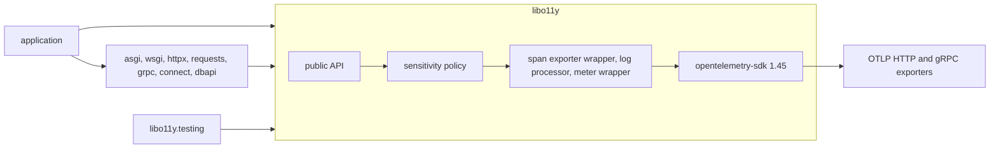

# libo11y Python

Date: 2026-11-27. Status: approved by the owner in brainstorming.

## Goal

libo11y Python implements the design contract in [DESIGN.md](../DESIGN.md) for Python programs. It matches the Go implementation wherever a Go capability applies to Python. It is released as `python/v0.1.0` on PyPI once every step below has landed. The family design ([2026-11-18](2026-11-18-libo11y-family-design.md)) did not cover Python, so this document starts it as a program of its own.

## Where things stand

- The repository has no `python/` directory.
- The PyPI names `libo11y` and `libo11y-test` are free (2026-11-27).
- OpenTelemetry Python is at 1.45.2 for the API, the SDK and the OTLP exporters, and at 0.66b2 for the semantic conventions and contrib packages. All of them require Python 3.10 or later.
- The development machine has Python 3.13.13 from home-manager. It has no uv, ruff or pyright.
- Go (`go/v0.2.0`), TypeScript (`ts/v0.2.0`) and Zig (`zig/v0.1.0`) are released. Rust is in progress. Each language has a target in `go/internal/specgen` and runs the shared `conformance/` suite.

## Findings that shaped the design

A review of OpenTelemetry Python 1.45.2 on 2026-11-27 found the following.

- **Local providers work.** `TracerProvider`, `MeterProvider` and `LoggerProvider` work without being installed as globals, so a non-global constructor can be built on them.
- **The logs SDK is private.** It lives in `opentelemetry.sdk._logs`, and the logs API in `opentelemetry._logs`. Both can change in any minor release.
- **Shutdown takes no deadline.** `TracerProvider.shutdown()` takes no timeout. The batch processors block for up to 30 seconds by default. `MeterProvider.shutdown` takes `timeout_millis`, but the span and log paths do not.
- **The SDK reads the environment on its own.** Each OTLP exporter reads `OTEL_EXPORTER_OTLP_*` for any argument left as `None`. `SpanLimits`, the batch processors (`OTEL_BSP_*`, `OTEL_BLRP_*`), the default sampler, `Resource.create` and the exemplar filter do the same. Two reads cannot be turned off by passing values: `LoggerProvider` reads `OTEL_SDK_DISABLED`, and the exporters read `OTEL_PYTHON_SDK_INTERNAL_METRICS_ENABLED`.
- **Views can only keep keys.** A Python `View` takes `attribute_keys`, a set of keys to keep. It cannot drop a named key or classify a value. The key-based policy cannot be written as a View, because the set of keys to keep is not known in advance.
- **Exemplars and overflow exist.** The SDK has the trace-based, always-on and always-off exemplar filters, the aligned-histogram and simple fixed-size reservoirs, and per-stream cardinality limits that mark the overflow series `otel.metric.overflow=true`.
- **Contrib instrumentation uses the old conventions by default.** The `opentelemetry-instrumentation-*` packages emit the old HTTP conventions, such as `http.server.duration` in milliseconds, unless `OTEL_SEMCONV_STABILITY_OPT_IN` is set. They read that variable once per process, in `_OpenTelemetrySemanticConventionStability._initialize`. That conflicts with the specification and with hermetic mode, so libo11y does not wrap them.
- **Context is ambient.** The OpenTelemetry context API stores the current context in a `contextvars.ContextVar`. It follows `asyncio` tasks. It does not follow work handed to a `ThreadPoolExecutor` or a queue unless the caller copies the context.

## Decisions

- **P-D1. Upstream SDK.** libo11y wraps `opentelemetry-sdk` and the OTLP exporters, pinned to `==1.45.*`. It applies the policy at the SDK's seams rather than by patching SDK internals: a wrapping span exporter, a log processor and a policy-wrapping meter provider. All use of `opentelemetry.sdk._logs` sits behind one internal module.
- **P-D2. Python 3.12 and later.** CPython 3.12, 3.13 and 3.14 are supported. PyPy is not.
- **P-D3. One distribution.** One PyPI distribution, `libo11y`, holds every module. Integrations that need a third-party library are optional extras.
- **P-D4. The standard `logging` module is the front door.** libo11y has no logger of its own. structlog users route through the standard library.
- **P-D5. Own integrations.** libo11y implements the stable HTTP, RPC and database conventions itself and depends on no `opentelemetry-instrumentation-*` package.
- **P-D6. Explicit environment.** libo11y reads `os.environ` by default, as Go does. The `env` option takes a mapping instead, and `env=libo11y.HERMETIC` reads nothing. libo11y passes every value to the SDK explicitly, so no `OTEL_*` variable can change a hermetic SDK.
- **P-D7. Toolchain.** uv manages the project, the lockfile and builds. ruff formats and lints. pyright checks types in strict mode. pytest runs the tests. Development machines get uv, ruff and pyright through home-manager. CI installs uv with `astral-sh/setup-uv`, pinned by commit.
- **P-D8. Integrations.** `asgi`, `wsgi`, `httpx`, `requests`, `grpc`, `connect` and `dbapi`.

## Package layout

The project lives in `python/` as a uv project with a `src/` layout. It ships `py.typed`.

| Module | Purpose | Extra |
|---|---|---|
| `libo11y` | The core: `setup` and `init`, options, identity and resource, the policy, the logging handler, events and records, the canary, shutdown, propagation, `libo11y.detached`, `libo11y.proc`, `libo11y.redact` and `libo11y.spec` (generated) | none |
| `libo11y.testing` | The hermetic recorder, assertions, in-process OTLP/HTTP and OTLP/gRPC receivers, and a pytest plugin | `test` |
| `libo11y.asgi` | ASGI middleware, with route templates for Starlette, FastAPI and Django | none |
| `libo11y.wsgi` | WSGI middleware, with route templates for Flask and Django | none |
| `libo11y.httpx` | Sync and async httpx transports | `httpx` |
| `libo11y.requests` | A requests `HTTPAdapter` | `requests` |
| `libo11y.grpc` | Server and client interceptors for grpcio, sync and `grpc.aio` | `grpc` |
| `libo11y.connect` | Connect RPC interceptors | `connect` |
| `libo11y.dbapi` | A DB-API 2 wrapper with psycopg 3 and sqlite3 dialects | `psycopg` for psycopg and psycopg_pool, none for sqlite3 |

The core depends on `opentelemetry-api`, `opentelemetry-sdk`, `opentelemetry-exporter-otlp-proto-http` and PyYAML. OTLP over gRPC needs grpcio, so `opentelemetry-exporter-otlp-proto-grpc` comes with the `grpc` extra. Selecting the `grpc` protocol without it raises `UnsupportedProtocol`, and the message names the extra. `libo11y._internal` holds the SDK wiring and is not public API.

## Public API idiom

- `libo11y.setup(options=None, **kwargs)` installs the globals and the `logging` route, then runs the startup canary. A second call raises `AlreadySetup`. `libo11y.init(...)` builds an SDK without globals or a canary. Both return a `Telemetry`.
- `Telemetry` is a context manager. Leaving the `with` block shuts it down.
- Errors derive from `O11yError`: `AlreadySetup`, `NoServiceName`, `NoEnvironment`, `InvalidEnvironment`, `PIIHashKey`, `InvalidAppRegistry`, `CanaryRejected`, `UnsupportedProtocol` and `ExporterError`. Each carries Go's message text.
- `Options` is a frozen dataclass. `setup` and `init` also accept its fields as keyword arguments. A field set in code wins over the environment, and the environment wins over the default.
- Calls on the hot path never raise into the host. These are logging, recording a measurement, ending a span and emitting an event. Internal failures go to the error handler, which writes to `sys.stderr` directly and never through `logging`.
- The public API is fully typed and passes pyright in strict mode.

## Core design

### Context

libo11y uses the OpenTelemetry context API and keeps no trace state of its own. `libo11y.detached.copy_context()` wraps a callable so that it runs in a copy of the caller's context. An executor or a queue consumer uses it to keep the trace.

### Traces

Spans come from the SDK `TracerProvider`. The samplers are always on, always off, trace id ratio and parent-based. `OTEL_TRACES_SAMPLER` and `OTEL_TRACES_SAMPLER_ARG` select them, and the `sampler` option wins over both. `SpanLimits` and the batch processor settings are passed explicitly. A wrapping span exporter applies the policy to span, event and link attributes before the batch leaves the process, as Go's `spanredact` does. It forwards a batch that needs no redaction unchanged.

### Metrics

`Telemetry.meter_provider` is a policy-wrapping `MeterProvider`. Its instruments classify each measurement's attributes when it is recorded, and they classify the observations from observable callbacks. Classification happens before the SDK sees the attributes, so every stream a View derives and every exemplar is covered. PII is dropped even in hash mode, because a token per value multiplies series. `setup` installs the wrapping provider as the global, so third-party instruments are covered too. The exemplar filter is trace-based by default. Always-on and always-off are selectable in code and through `OTEL_METRICS_EXEMPLAR_FILTER`. User Views pass through to the SDK. Each stream keeps at most 2000 series. Temporality is cumulative by default, and `OTEL_EXPORTER_OTLP_METRICS_TEMPORALITY_PREFERENCE` can select delta.

### Logs

`setup` attaches a `logging.Handler` to the root logger. `init` attaches nothing and exposes `telemetry.logging_handler()`. The handler takes attributes from a record's `extra` fields. It reads the trace and span ids from the active context when the record is emitted. It fans each record out to a console leg and an OTLP leg. The console leg writes JSON lines in the Go console format to `sys.stdout`, or to the text stream in the `console_writer` option. Both legs apply the user's attribute replacer and then the policy. The policy walks nested values and fails closed past depth 16, on a cycle, or past a budget of 2048 nodes. `libo11y.force_emit()` returns a context manager whose records bypass level gates. A context-local re-entrancy guard keeps the SDK's own logging from looping back into the handler.

### Export

`OTEL_TRACES_EXPORTER`, `OTEL_METRICS_EXPORTER` and `OTEL_LOGS_EXPORTER` accept `otlp`, `console` and `none`. Any other value, including `prometheus`, raises `UnsupportedProtocol`, as in TypeScript and Zig. OTLP over HTTP sends protobuf. The `OTEL_EXPORTER_OTLP_*` variables set endpoints, headers, timeouts, compression, a CA bundle and client certificates, both general and per signal. libo11y reads them and passes the values to the exporters.

### Shutdown

One shutdown is elected under a lock. The three signals flush on their own threads under one deadline, 5 seconds by default. `shutdown` returns a `ShutdownReport` with one error per signal that failed or missed the deadline. Later and concurrent callers get the same report. Python cannot stop a thread, so a signal that misses the deadline keeps flushing on a daemon thread after `shutdown` returns. The report names it, and the README documents it. `await telemetry.ashutdown()` runs the same shutdown without blocking the event loop. `libo11y.shutdown_on_signals()` waits for SIGINT or SIGTERM, restores default handling, runs an optional `before_shutdown` callback and the shutdown under one deadline, and returns the report. An asyncio form installs the handlers on the running loop.

### Identity and resource

Setup refuses to start without a `service.name` and a valid `deployment.environment.name`, unless the application turns off strict identity in code. It derives `service.instance.id` with the shared derivation in `conformance/vectors/instance-id.json`. The resource holds the telemetry SDK attributes, `host.name`, `process.runtime.*`, the container id, the environment resource and explicit attributes, with explicit attributes highest. The policy classifies the resource once, when it is built. The resource carries the specification's `schema_url`.

Python packages carry no VCS information. `service.version` comes from the `version` option, or from `importlib.metadata` when the `distribution` option names the application's distribution. `python -m libo11y.buildinfo out.json` records `vcs.ref.head.revision`, `o11y.build.time` and `o11y.build.modified` from git at image build time, and the `build_info` option reads that file. An application may omit both.

### Runtime metrics

The runtime metrics are on by default. They are the semantic-convention `cpython.gc.collections`, `cpython.gc.collected_objects` and `cpython.gc.uncollectable_objects`, plus `process.cpu.time`, `process.memory.usage`, `process.thread.count` and `process.unix.file_descriptor.count`. They come from `gc`, `resource`, `threading` and `/proc` on Linux, with no psutil. `runtime_metrics=False` turns them off.

### Sensitivity policy

One key-based policy per SDK reads the generated specification tables and any application registry. Secret attributes are always dropped. PII is dropped by default, replaced by a keyed HMAC token in hash mode with the token format in `conformance/vectors/pii-hash.json`, or kept. The policy runs after the user's attribute replacer. Violations increment the `o11y.schema.violations` counter. The gaps match Go's and are documented in the README: log message text, span names and other free text, instrumentation scope attributes, members of map-valued attributes, attributes a processor reads at span start, and baggage.

### Redaction types

`libo11y.redact.Secret[T]` renders `REDACTED`. `libo11y.redact.Masked[T]` renders a same-length string of `X`. The `@libo11y.redact.redacted` dataclass decorator reads field tags from `Annotated` metadata: `mask`, `redact`, `omit`, and the synonyms `confidential` and `secret`. The decorator rejects an unknown tag with `TypeError` when the class is defined, so a typo fails at import rather than leaking at run time. Each type implements `__repr__`, `__str__` and `__format__`, and the logging handler's walk honours them, so the protected form appears on every surface that renders the value.

### Application registry

The `app_registry` option names a file. Setup validates it with the rules and messages of the Go validator and classifies its keys like specification keys on every signal. The validator composes the YAML into nodes with PyYAML and resolves tags with libo11y's own resolver, which follows yaml.v3 rather than YAML 1.1. It produces the parse-error kinds that `conformance/README.md` requires, with Go's `%q` quoting through the generated `goprint` ranges. The 92 cases in `conformance/appregistry/` gate it.

### Events and wide events

`telemetry.event(name, attributes)` emits a registered event and checks it against the specification's event contracts. `libo11y.start_record()` returns a context manager that carries a `Record` accumulator for a canonical line. The startup canary forces `o11y.telemetry.configured` through the pipeline with the `o11y.config.*` attributes, and a sink that rejects it fails `setup` with `CanaryRejected`. `telemetry.effective_config()` returns the same values. Endpoints are sanitized as in `conformance/vectors/endpoint-sanitize.json`.

### Propagation and detached work

The default propagator is W3C tracecontext plus W3C baggage, and the `propagators` option replaces it. An inject-only baggage egress filter wraps every configured propagator, with a predicate that allows every key, as in Go. `telemetry.inject` and `telemetry.extract` work the same whether or not `setup` installed globals. `libo11y.detached.capture()` returns a `Carrier` of at most 32 KiB that serializes as text, and `start_linked` starts a linked root span and merges the carrier's baggage. `libo11y.proc` injects and extracts `TRACEPARENT` and `TRACESTATE` environment carriers for child processes, with an SDK-scoped form that needs no globals.

### Hermetic mode and upstream gaps

With `env=HERMETIC`, libo11y passes every setting the SDK would read from the environment explicitly. Two reads cannot be overridden: `OTEL_SDK_DISABLED` in `LoggerProvider` and `OTEL_PYTHON_SDK_INTERNAL_METRICS_ENABLED` in the exporters. A hermetic SDK checks after construction that its providers are live, and raises `O11yError` if `OTEL_SDK_DISABLED` disabled one. The internal metrics flag adds SDK self-metrics but changes no recorded telemetry. PARITY.md lists both as gaps. P2 inventories every environment read in the pinned SDK and adds a test for each.

## Integrations

- **`asgi`.** ASGI middleware for any ASGI 3 application. It names server spans from the route template: the Starlette and FastAPI `route.path`, and Django's `resolver_match.route`. It records the stable HTTP semantic conventions and `http.server.request.duration` with exemplars. Its options are `public_endpoint`, `ignore_paths` globs, a filter, a canonical line and a `Server-Timing` traceparent. An exception from the application marks the server span as an error and is re-raised.
- **`wsgi`.** The same middleware for WSGI applications, with route templates from Flask's `url_rule` and Django's `resolver_match`.
- **`httpx`.** Sync and async transports that wrap an inner transport. They inject context and record client spans and `http.client.request.duration`.
- **`requests`.** An `HTTPAdapter` with the same behaviour, mounted on a `Session`. libo11y does not patch `requests` globally, so the OTLP exporter's own requests are never instrumented.
- **`grpc`.** Server and client interceptors for grpcio, sync and `grpc.aio`, with the RPC semantic conventions and `rpc.server.duration` and `rpc.client.duration`.
- **`connect`.** Server and client interceptors for the official Connect Python library, with the canonical line from `o11yconnect`. The P0 spike picks between `connectrpc` 0.13 and `connect-python` 0.9.
- **`dbapi`.** A wrapper for DB-API 2 connections and cursors. It emits client spans only under a parent span, sanitized `db.query.text` for PostgreSQL and SQLite, `db.client.operation.duration` with exemplars, and pool metrics for psycopg_pool.

## Testing

- Tests are written first, with pytest and pytest-asyncio.
- The conformance suite reads `conformance/` from the repository and checks the instance id, the PII token, endpoint sanitizing and every registry case. The published distribution does not include it.
- A parity test mirrors `go/parity_test.go`.
- Wire tests run in-process OTLP/HTTP and OTLP/gRPC receivers. They decode real payloads through the OTLP protobuf bindings and assert identity, the policy on every signal, exemplars and log-to-trace correlation.
- A hostile-environment test sets every `OTEL_*` variable the SDK reads to a hostile value and checks that a hermetic SDK ignores them.
- Concurrency tests cover shutdown racing emits from threads and tasks, and a full batch queue.
- hypothesis property tests cover traceparent, tracestate, baggage and the registry YAML subset.
- `dbapi` tests run against a PostgreSQL service container in CI and are skipped locally unless a DSN is set. The sqlite3 tests use the standard library. The HTTP and gRPC integrations test against loopback servers.
- pytest-xdist parallelism is capped at a quarter of the cores.

## Quality gates

`make python-check` runs `ruff format --check`, `ruff check`, pyright in strict mode, and pytest with branch coverage. It also runs a hygiene script under `scripts/`, which fails on `print`, `breakpoint`, a bare `except` or `except BaseException` outside tests. CI runs `make python-check` on Linux and macOS for Python 3.12, 3.13 and 3.14. `make ci` runs it locally. `make spec-drift` covers the generated Python files.

## Specification codegen

`go/internal/specgen` gains a Python target, `genpython.go`, beside the TypeScript, Rust and Zig targets. It writes `python/src/libo11y/spec/_generated/` with the attribute keys, enums, event names and contracts, the sensitivity and cardinality tables, the reserved namespaces and the printable ranges of Go's `unicode.IsPrint`. `make spec-generate` writes them, and `make spec-drift` checks them. The target adds generated output only, so it needs no specification release and no Go release.

## Delivery

Each step gets its own detailed plan in `~/.claude/plans/libo11y/`. Every step lands on `main` through a reviewed PR with green CI.

| Step | Contents |
|---|---|
| P0 | The home-manager change in my-dotfiles for uv, ruff and pyright, the `python/` skeleton, `make python-check`, the CI workflow, and spikes on the PyYAML composer against the registry cases, the Connect library, grpcio wheels on every CI platform and uv's Python on NixOS. The spike results are recorded in this document as amendments |
| P1 | The Python codegen target, the drift gate, the vectors and the registry validator passing the conformance suite |
| P2 | The core: setup and init, options and environment, hermetic mode, identity and resource, build info, the policy on all three signals, the logging handler, shutdown and `shutdown_on_signals`, the canary and effective config, events and records, redact types and runtime metrics |
| P3 | `libo11y.testing` with the receivers, the pytest plugin and the parity test |
| P4 | `libo11y.detached` and `libo11y.proc` |
| P5 | `asgi`, `wsgi`, `httpx` and `requests` |
| P6 | `grpc` and `connect` |
| P7 | `dbapi` |
| P8 | The release: the `python` route in `scripts/release-tag.sh`, PyPI trusted publishing, the consumer smoke test, the PARITY columns, the README, the CHANGELOG and the o11y.ing site |

P0 comes first, and P1 and P2 follow it in order. P3 follows P2. P4 to P7 follow P3 and can run in parallel. P8 comes last.

## Release

- Tags are `python/vX.Y.Z`. `PYTHON_RELEASE_VERSION` in the Makefile moves only in a release commit, together with the version in `python/pyproject.toml`.
- `scripts/release-tag.sh` gains a `python` route. It checks that the version is semantic, that `pyproject.toml` carries it and that `python/CHANGELOG.md` has its section, then runs `make python-check`.
- The release workflow builds an sdist and a wheel with `uv build` and publishes them to PyPI through trusted publishing, with attestations. It then publishes a GitHub Release titled `libo11y-python vX.Y.Z` with the changelog section as notes, never marked Latest, so the Go module keeps Latest.
- Before the first publish, the owner registers a PyPI pending publisher for `libo11y` that trusts the release workflow, because that needs the owner's PyPI login. No token is stored.
- A smoke job installs the published version into a fresh virtual environment and runs an example against an in-process OTLP receiver.

## Documentation

- `python/README.md` with a quick start, the per-signal guarantees and the documented gaps.
- `python/CHANGELOG.md` in Keep a Changelog format.
- Python status and form columns in `docs/PARITY.md`.
- A Python toolchain section in `docs/CONVENTIONS.md` and the Python idiom notes in `docs/DESIGN.md`.

## Out of scope

- aiohttp, Tornado, SQLAlchemy events and Celery.
- PyPy and Python before 3.12.
- A Prometheus exporter.

## Risks

- **Private logs SDK.** `opentelemetry.sdk._logs` can change in any minor release. libo11y pins `==1.45.*`, keeps its use behind one module, and moves to a new minor line deliberately with its own release.
- **Threads after the deadline.** A flush that misses the shutdown deadline keeps running on a daemon thread. The report says so, and the interpreter exits without waiting for it.
- **Environment reads in the SDK.** A new SDK version can add a read that hermetic mode does not cover. The hostile-environment test and the inventory in P2 catch the reads in the pinned version, and the test runs again on every SDK upgrade.
- **Connect Python.** Both Connect libraries are pre-1.0. If neither has stable interceptors, `connect` waits for upstream and the owner decides whether `python/v0.1.0` ships without it.
- **YAML fidelity.** PyYAML implements YAML 1.1, and the Go validator uses yaml.v3. libo11y resolves tags itself and uses PyYAML only to compose nodes. The conformance cases and the property tests gate the difference.

## P0 spike amendments

Recorded during P0 (2026-11-27):

- **PyYAML composer vs conformance cases.** PyYAML's pure-Python `SafeLoader` (`yaml.scanner.Scanner.ESCAPE_REPLACEMENTS`) differs from Go's `yaml.v3` in two double-quoted escapes: it accepts `\/` (which `yaml.v3` rejects in `escape-slash.yaml`) and rejects `\'` (which `yaml.v3` accepts in `escape-quote.yaml`). Subclassing PyYAML's pure-Python loader to drop `\/`, add `\'`, reject surrogate escapes and non-1.1 `%YAML` directives, and building our own lazy alias-aware AST from PyYAML's event stream (enforcing `yaml.v3`'s alias expansion budget against `alias-bomb.yaml`) handles all 46 conformance YAML cases cleanly with `PyYAML` as the sole YAML dependency.
- **Connect RPC library.** `connectrpc` 0.13.0 (`github.com/connectrpc/connect-py`, updated 2026-10) is selected over `connect-python` 0.9.0 (`github.com/connectrpc/connect-python`, last updated 2026-03). `connectrpc` provides typed async and sync interceptors (`UnaryInterceptor`, `ServerStreamInterceptor`, `ClientStreamInterceptor`, `BidiStreamInterceptor`, `MetadataInterceptor` and their `Sync` counterparts), ASGI and WSGI applications, and sync/async clients, and coexists cleanly with `opentelemetry-sdk==1.45.*`.
- **`grpcio` wheels.** `grpcio` 1.85.4 ships `manylinux` (`x86_64`, `aarch64`) and `macosx_11_0_universal2` wheels for CPython 3.12, 3.13 and 3.14.
- **`uv` on NixOS.** The host has `nix-ld` enabled and home-manager provides `python3` 3.13.13, `uv` 0.11.21, `ruff` 0.15.14 and `pyright` 1.1.411. `uv` discovers the home-manager Python and creates/runs virtual environments cleanly.
