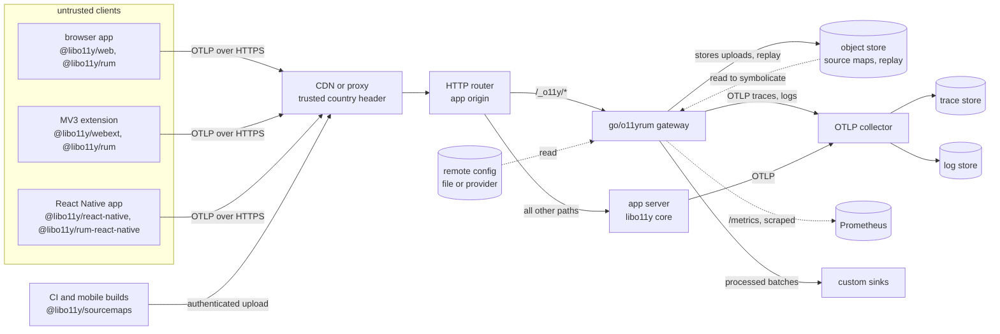
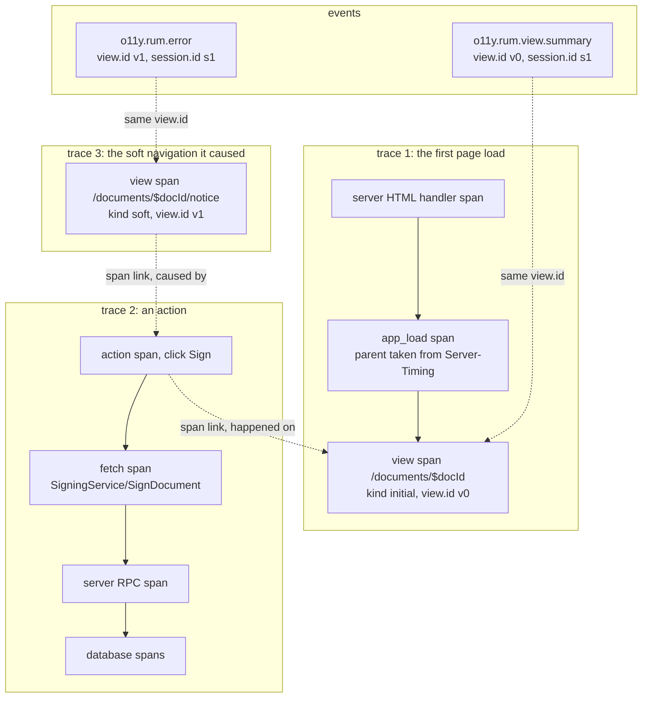

# libo11y RUM

Date: 2026-11-27. Status: approved by the owner in brainstorming.

## Goal

libo11y RUM records what real users experience in browsers, browser extensions and React Native apps. It joins that experience to the backend traces it caused. The [family design](2026-11-18-libo11y-family-design.md) set its charter and split it into steps L5 to L11. The conventions are in spec 1.2.0 and in [RUM.md](../RUM.md). This document fixes the architecture for the RUM steps: what the clients send, how traces are shaped, what the gateway does, where metrics come from and the order of delivery. Where it differs from the family design, this document wins.

## Where things stand

- Spec 1.2.0, the current version, defines the RUM attributes, the `view`, `action` and `app_load` span shapes, nine metrics and four events. Every RUM group has development stability.
- `@libo11y/web` and `@libo11y/webext` merged in #22. The `ts/v0.2.0` release never reached npm, because the trusted publishers allowed only staged publishing. They first shipped in `ts/v0.2.1`, with every `@libo11y/*` package.
- No RUM package exists. `go/o11yrum` does not exist.
- Go's `o11yhttp` cannot set `Server-Timing: traceparent` on HTML responses.
- The first consumer is the Life of Reily platform. Its portal SPA, its MV3 capture extension and its Expo phone app all send RUM, and its Go portal server joins their traces.

## Decisions

- **D1. The gateway runs as a shared service.** One gateway deployment serves every app in an environment. It does not run inside an application server. Apps reach it through a path on their own origin, `/_o11y/*`, which the operator's HTTP router sends to the gateway. A dedicated hostname with CORS stays available for apps that cannot have the path.
- **D2. Clients send events and the gateway computes metrics.** Browsers never export the standard RUM metrics. Every consented session sends a view summary when each view ends. The gateway derives the nine spec metrics from those summaries, so the metrics count every consented session whatever the sampling rate.
- **D3. Traces are short and correlated by attributes.** Each soft navigation, action and request is the root of its own trace or a child of the action that caused it. Nothing stays open for the life of a view. `session.id` and `o11y.rum.view.id` join the pieces, and span links record cause.
- **D4. Sampling keeps whole sessions.** The sampling decision is a hash of `session.id`, so every tab of a session agrees. A session that is not sampled buffers its detail and sends it if an error or a frustration signal occurs.
- **D5. Consent is decided by the app at runtime.** RUM records nothing before consent. The app decides the default per audience. For Life of Reily, studio staff are granted at sign-in, clients stay pending until they accept a notice, and GPC keeps a browser out.
- **D6. React Native ships JS-only first.** `@libo11y/rum-react-native` first ships without native code. It covers JavaScript errors, screen views and requests. Native crashes, ANRs and an accurate app start come with the Swift and Kotlin libraries of L9 and L10.
- **D7. Metrics come in three layers.** The gateway derives the standard metrics. The operator can define further metrics from incoming events in the gateway's configuration. Apps can still record custom metrics with the OpenTelemetry Meter API, and the gateway re-aggregates them across browsers.

## Architecture

Arrows point the way data moves. A solid arrow is pushed by its sender. A dashed arrow is pulled by its receiver.

- Every client posts OTLP/HTTP to `/_o11y/v1/traces` and `/_o11y/v1/logs` on the app's origin and reads `/_o11y/v1/config`. Same-origin requests need no CORS preflight, and blockers rarely block them.
- The gateway identifies an app by `service.name`, because extensions and mobile apps have no page origin. Each app has an entry in the gateway configuration with its allowed origins, limits, remote configuration, source map namespace and an optional public client token. The token identifies the app and can switch it off. It is not a secret.
- The gateway exports its derived metrics through its own libo11y meter provider. An operator chooses OTLP push or a Prometheus endpoint with the usual `OTEL_METRICS_EXPORTER` setting. The diagram shows the Prometheus endpoint.

## What a client sends

1. **Nothing before consent.** In the `pending` state the client records nothing, buffers nothing and sends nothing. Revoking consent clears every queue and buffer.
2. **A view summary for every consented session.** When a view ends, or the page is first hidden, the client sends one `o11y.rum.view.summary` event. It carries the view name and kind, the time on the view, the counts of errors, frustration signals, requests and long animation frames, and each web vital's value. The gateway rates it against the thresholds the spec publishes.
   - Counts are deltas since the previous summary of the same view, so several summaries for one view add up correctly.
   - Each vital is reported once per view, in the first summary sent after the vital is known. A CLS or INP change after the page returns from hidden is left out of the metrics. Kept sessions still record it in their detail events. This differs from CrUX, which reports final values, and the spec states the difference.
3. **Detail for kept sessions.** Spans, `o11y.rum.error`, `o11y.rum.frustration`, the session events and the semconv `browser.web_vital` event with attribution go out only for kept sessions.
4. **A buffer for sessions not yet kept.** Detail is held in the transport's IndexedDB store, capped at 2 MiB and 15 minutes by default, so a reload does not lose it. An error or frustration signal sends the buffer and keeps the rest of the session. The session's `o11y.rum.session.retained` value records why it was kept. A session that ends without being kept discards its buffer.

A session ends after 15 minutes without activity or after 4 hours, whichever comes first. Tabs share it through `localStorage` and a `BroadcastChannel`. An extension keeps it in `chrome.storage.session`.

The client loads in two parts. A small bootstrap runs inline and buffers. The collectors load after the `load` event and replay the buffer.

## Trace shape

A solid arrow runs from parent to child. A dashed arrow is a span link or a shared `view.id`, as labelled.

- **The first page load joins the backend.** The server sets `Server-Timing: traceparent;desc=...` on the HTML response. The `app_load` span takes its parent from the navigation entry, so it becomes a child of the server's HTML span.
- **A view span covers getting into the view, not the time spent on it.** For the initial view it is a child of `app_load` and ends at the first paint after the routed view renders. For a soft navigation it is a root span. It starts at the route change and ends at the first paint after the new route renders, capped at 10 seconds. The router adapter reports both points. Time on view goes in the view summary.
- **An action span ends when the work it caused settles.** It ends when its requests have finished and the page has been idle for 100 ms, capped at 10 seconds. The requests it caused are its children. It links to the view it happened on. A view it caused links back to it.
- **Requests no action caused are roots.** Polling and long-lived streams start their own traces and link to the current view. A stream's span covers the stream.
- **Propagation is restricted.** `traceparent` goes only to the same origin and to origins on an explicit allow-list.
- **Every RUM span and event carries `session.id` and `o11y.rum.view.id`.** Session start and end events carry only `session.id`. A session explorer rebuilds a session by searching spans and events for its `session.id` and merging them by view. Log stores must keep both IDs as structured metadata, never as index labels, because both are unbounded.

## The gateway

`go/o11yrum` is a separate Go module. `o11yrum.NewHandler(opts...)` returns an `http.Handler`, and `cmd/o11yrum-gateway` wraps it for a container image. It is stateless apart from the object store, so it scales by adding replicas.

Each batch goes through these stages in order.

1. **Edge checks.** The gateway checks the origin against the app's allow-list. It caps the compressed body at 512 KiB and the decompressed body at 5 MiB by default. It refuses an unknown `service.name`. It rate-limits each client by a hash of the client address that it keeps only in memory, at 60 requests a minute by default. It answers 403, 413 or 429, with `Retry-After` on 429.
2. **Validation.** The gateway checks the OTLP shape and the RUM span shapes and events against the spec. It caps attribute counts and value lengths. It drops resource keys that only a server may set, such as `host.*`, `k8s.*` and `service.instance.id`. It re-applies the sensitivity policy, so a modified client cannot pass a `pii` attribute.
3. **Enrichment.** The gateway parses the user agent into `o11y.rum.browser.family`, the OS and `o11y.rum.device.class`. It reads the country from a header the operator names, such as `CF-IPCountry`. It trusts that header only from proxy addresses the operator lists, and ignores it from anywhere else. It corrects clock skew: the client sends its send time, and the gateway shifts every timestamp in the batch by the difference from its own clock. It then discards the client address.
4. **Symbolication.** The gateway resolves minified frames with the source map for the batch's `service.version` and the script URL. It computes `o11y.rum.error.fingerprint` from the resolved frames.
5. **Sinks.** The `Sink` interface receives each processed batch. The built-in sink exports OTLP to a collector. When a sink fails, the gateway answers 503, and the client keeps the batch in its retry queue. The gateway has no disk buffer.
6. **Metric derivation.** It runs only after the sinks accept the batch, so a batch the client retries after a 503 is not counted twice. The aggregator turns view summaries into the standard metrics. It evaluates the operator's metric definitions against incoming events. It re-aggregates app metrics with the per-browser resource identity removed. A metric definition may group only by bounded or enum attributes, and the gateway refuses a configuration that breaks this rule.

Other endpoints:

- `GET /_o11y/v1/config` serves the app's remote configuration with an ETag. The configuration comes from a file or a provider interface. Each version has an identifier, and each session records it as `o11y.rum.config.version`. A client applies remote values only inside the limits its code sets. Remote configuration can never lower masking or switch on a collector the app did not install.
- `POST /_o11y/v1/sourcemaps` takes uploads authenticated with a bearer token and stores them in the object store, keyed by `service.name` and version. It never serves them back.
- `POST /_o11y/v1/replay` and the internal replay read API arrive with replay in L7.

The gateway reports on itself through the libo11y Go core. It records accepted and rejected batches with the reason, the symbolication hit rate, aggregator series counts and sink latency.

## Releases and symbolication

- A browser build sets `service.version` to the version of the artifact it ships in. The build uploads its source maps under that version with `@libo11y/sourcemaps` and leaves them out of the published bundle.
- A React Native store build produces Hermes source maps, iOS dSYMs and the Android R8 mapping. An over-the-air update produces Hermes source maps only. A JavaScript stack therefore needs the app version and the update ID to find its map, and the client records both. The gateway uses dSYMs and R8 mappings only once L9 and L10 add native crash reporting.

## Privacy

- Text capture is off by default. `o11y.rum.element.text` is classified `pii` and is dropped in the default PII mode.
- Action names come only from `data-o11y` labels or a privacy-safe accessible name. RUM never records form values.
- URL query strings are stripped unless a parameter is on the app's allow-list, which is empty by default. View names are route templates, never raw URLs.
- An extension's content scripts record only the extension's own UI and errors. They never record the host page's text, and they record the page's host but not its full URL.
- `identify()` takes a pseudonymous ID that the app registry classifies `internal`. Email addresses are never accepted as IDs.
- Replay, from L7, masks all text and inputs by default.

## Specification changes

Spec 1.3.0 adds the following. Every new group has development stability.

- The event `o11y.rum.view.summary` with its attributes: the time on the view, the delta counts and the vital values.
- The view span's timing rule and the action span's settle rule, written into the span shape briefs.
- A statement that the gateway derives the standard RUM metrics and that clients do not export them.
- The once-per-view vital rule and its difference from CrUX.
- `o11y.rum.app.update_id` for over-the-air update identifiers.

## Delivery

| Step | Contents | Release | Family step |
|---|---|---|---|
| R0 | Allow direct publishing on every trusted publisher and publish `@libo11y/web` and `@libo11y/webext`. Done in `ts/v0.2.1`, because `ts/v0.2.0` never reached npm. | `ts/v0.2.1` | L4 |
| R1 | Spec 1.3.0 as above, with codegen for every language target. | `spec/v1.3.0` | new |
| R2 | `o11yhttp` sets `Server-Timing: traceparent` on HTML responses when asked. | the next `go/vX.Y.Z` | new |
| R3 | `@libo11y/rum`: sessions, consent wiring, sampling and the retention buffer, views, vitals with attribution, resources, actions, frustration signals, errors with breadcrumbs, view summaries, the remote configuration client and the two-part loader. `rum-react`, `rum-tanstack-router` and `rum-connect`. | the next `ts/vX.Y.Z` | L5 |
| R4 | `go/o11yrum` and `cmd/o11yrum-gateway` with every stage and endpoint above except replay. `@libo11y/sourcemaps`. | `go/o11yrum/v0.1.0`, a `ts/vX.Y.Z` | L6 |
| R5 | `@libo11y/react-native` and a JS-only `@libo11y/rum-react-native`. A new package, `@libo11y/rum-expo-router`, names screens by route. | a `ts/vX.Y.Z` | part of L11 |
| R6 | Replay: `rum-replay` and the gateway's replay storage and read API. | a `ts/vX.Y.Z`, `go/o11yrum/v0.2.0` | L7 |
| R7 | Ops pack: dashboards, alert rules and the Grafana session explorer. | `ops/v0.1.0` | L8 |
| R8 | Native mobile: iOS and Android libraries, native crashes, ANRs and app start, and dSYM and R8 symbolication in the gateway. React Native gains its native module. | per the family design | L9, L10, L11 |

R0 comes first, because every RUM package depends on `@libo11y/web`. R1 and R2 can run alongside it. R3 and R4 follow R1 and can run in parallel. R5 follows R3. R6 follows R3 and R4. R7 can start its dashboards once R4 exports metrics. TypeScript packages keep lockstep versions, so each `ts/vX.Y.Z` release number is decided when that release is prepared.

A package that is new to npm cannot be published by trusted publishing, because the registry needs the package to exist before it can trust a workflow. Its first version needs the owner's npm login. That step must not hold a release back, so the release workflow skips a package the registry does not have yet, attaches every packed tarball to the GitHub Release, and the release is complete without it. A consumer can install a tarball from the release until the package reaches npm.

## Testing

- `bun test` and a Node run for every TypeScript package, with Playwright on Chromium, Firefox and WebKit for the collectors.
- `go test` for the gateway, with table tests per stage and a fuzz target for each decoder. Fuzzing beyond the default short run needs the owner's approval.
- An end-to-end Playwright journey: a fixture app sends through a real gateway to the fake OTLP sink in `@libo11y/test`. It asserts the trace shape, the summaries, the derived metrics and a symbolicated stack.
- Shared conformance vectors for the view summary and the derived metrics, so every client language produces the same records.
- A size budget per collector and an overhead benchmark for main-thread time per view and per interaction, both recorded in CI as the family design requires.

## Out of scope

- A hosted backend. Data stays in the operator's own stores.
- Recording form values, keystrokes or unmasked text.
- Native mobile features before R8.

## Risks

- **The view summary is a new record type.** Spec 1.3.0 has to settle its attributes before R3 and R4 can build against it.
- **Sending a summary for every session adds traffic.** A summary is a few hundred bytes per view. The overhead benchmark measures it.
- **The country header can be forged** if the operator's proxy list is wrong. The gateway ignores the header from any address not on the list.
- **Retained sessions depend on IndexedDB.** In a private window, or where storage is blocked, the buffer falls back to memory and a reload loses it.
