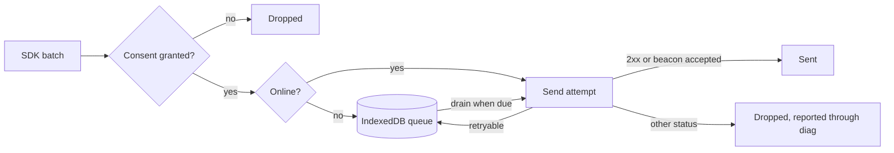

# @libo11y/web

The libo11y browser platform for TypeScript. It binds
[`@libo11y/core`](https://github.com/jamesainslie/libo11y/tree/main/ts/packages/core) to the browser.
`setup()` runs the OpenTelemetry JS 3.x providers with a pluggable context
manager and a browser resource. Telemetry leaves the page over OTLP/HTTP
JSON, gzip-compressed where the browser has `CompressionStream`. Batches
sent while the page is hidden go by `fetch` keepalive or `sendBeacon`.
Retryable failures wait in an IndexedDB queue that honours `429` and
`Retry-After`. A consent gate decides whether anything is recorded at
all. The package also records `fetch`, XHR and document-load spans, and
it sends `traceparent` only to the page's origin and an allow-list.

It has no RUM features. Those belong to `@libo11y/rum`.

```sh
npm install @libo11y/web
```

## Quick start

```ts
import { setup } from "@libo11y/web";

const telemetry = await setup({
  serviceName: "storefront",
  environment: "production",
  serviceVersion: "1.4.0",
  endpoint: "https://otlp.example.com",
  instrumentations: { propagateTo: ["https://api.example.com"] },
});

// Nothing is recorded until consent is granted. cmp stands for the
// page's consent management platform.
cmp.onAccept(() => telemetry.consent.grant());
cmp.onWithdraw(() => telemetry.consent.revoke());

telemetry.logger.info("storefront started");
```

`setup` takes core's
[`TelemetryOptions`](https://github.com/jamesainslie/libo11y/tree/main/ts/packages/core#options)
and the browser options below. It installs the providers, the propagator
and the context manager globally, as the server's `setup` does, and it
emits the `o11y.telemetry.configured` canary. A second call fails with
`O11yError` code `ALREADY_SETUP` until the first telemetry shuts down.
`setup` then patches `globalThis.fetch` and `XMLHttpRequest`, records the
document-load span, flushes when the page is hidden, and drains any batches
an earlier page of the origin left in the queue.

`createTelemetry` builds the same pipeline without any global. It
installs no providers, propagator or context manager, patches nothing,
emits no canary and ignores `instrumentations`. It still flushes on hide
and drains the queue. Pass its handle as `telemetry` to `instrumentFetch`.

The console sink defaults to off in the browser. `console: "json"` or
`console: "text"` turns it on.

`telemetry.shutdown()` shuts the providers down, then removes the
instrumentation and the page listeners, stops the delivery and closes the
queue.

## Consent

`telemetry.consent` has three states.

| State     | Meaning                                                                        |
| --------- | ------------------------------------------------------------------------------ |
| `pending` | No decision yet. The default at setup                                          |
| `granted` | Record and send                                                                |
| `denied`  | The user refused or withdrew consent, or a respected privacy signal refused it |

In `pending` and `denied`, core records nothing. The sampler returns
`NOT_RECORD`, metric measurements and observable callbacks are skipped, and
no log record reaches the OTLP leg. A span that started while consent was
granted and ends after a revoke is dropped. Nothing is buffered, so nothing
from before the grant is sent after it. The console sink is not gated, because
nothing leaves the device through it. The `fetch` and XHR instrumentation
create no span and inject no header while consent is not granted.

- `consent.grant()` moves to `granted` and returns the new state. It
  returns `denied` when a respected privacy signal refuses it.
- `consent.revoke()` moves to `denied` before it returns. It then clears
  the IndexedDB queue at once and flushes the SDK buffers into the closed
  gate, where they are dropped. The queue is cleared whether the flush
  succeeds, fails or runs to its deadline. The promise resolves when the
  queues are clear and never rejects. A request already on the wire is not
  recalled.
- `consent.state()` returns the current state.
- `consent.subscribe(listener)` calls `listener` after every change and
  returns a function that unsubscribes.

| `consent` option              | Default     | Effect                                                                                  |
| ----------------------------- | ----------- | --------------------------------------------------------------------------------------- |
| `initial`                     | `"pending"` | the state at setup. Pass `"granted"` where no consent is needed, such as internal tools |
| `respectDoNotTrack`           | `false`     | `navigator.doNotTrack === "1"` starts the state at `denied` and refuses `grant()`       |
| `respectGlobalPrivacyControl` | `false`     | `navigator.globalPrivacyControl === true` does the same                                 |

The package does not store the consent state. Each page load starts at
`initial`, so call `grant()` on every load from the decision the consent
platform stored.

The deferred canary is the one record kept for a later grant. When setup
runs with consent closed, the `o11y.telemetry.configured` event goes to the
OTLP leg once, on the first grant.

## Endpoints and CORS

Browsers have no process environment, so the OTLP endpoint is an option.
Each signal resolves its URL in this order:

1. `tracesEndpoint`, `metricsEndpoint` or `logsEndpoint`, used as is.
2. `env.OTEL_EXPORTER_OTLP_<SIGNAL>_ENDPOINT`, used as is.
3. `endpoint` joined with `v1/traces`, `v1/metrics` or `v1/logs`.
4. `env.OTEL_EXPORTER_OTLP_ENDPOINT`, joined the same way.

A relative URL resolves against the page. A signal with no URL is off. A
URL that cannot be parsed turns its signal off and is reported through the
OpenTelemetry diag logger. The protocol is always `http/json`. A
per-signal protocol variable in `env` that names any other protocol fails
setup with `UNSUPPORTED_PROTOCOL`.

`env` stands in for `process.env`. It takes the same `OTEL_*` variables the
server reads, such as `OTEL_RESOURCE_ATTRIBUTES`, `OTEL_TRACES_SAMPLER` and
`OTEL_BSP_*`. Options beat it, and `hermetic: true` ignores it.

`headers` are sent with every export request.

A collector on another origin must answer the CORS preflight for `POST`
with the `Content-Type` and `Content-Encoding` request headers, plus any
header named in `headers`. It must also list `Retry-After` in
`Access-Control-Expose-Headers`. Without that, the browser hides the header
from the transport, and a `429` or `503` is retried on the backoff schedule
instead of the delay the collector asked for.

## Propagation

The `fetch` and XHR spans inject `traceparent`, `tracestate` and `baggage`
only into requests to the page's own origin and to origins on the
`propagateTo` allow-list. Every other request gets the span and no headers.
A `traceparent` the caller set on a `fetch` is replaced by the span's, as
`@libo11y/server` does. An XHR whose caller set `traceparent` (in any case)
gets no injected headers, because `setRequestHeader` appends to a header
already set. Its span is still recorded.

- A string entry is an origin, such as `"https://api.example.com"`. It is
  normalized through `new URL(entry).origin` and compared exactly.
- A `RegExp` entry is tested against the request's origin, such as
  `/^https:\/\/[a-z]+\.example\.com$/`.
- An opaque origin (`"null"`) never matches.

These are custom request headers, so a cross-origin service on the list
must allow them in `Access-Control-Allow-Headers`.

| `instrumentations` option | Default | Effect                                                                                                     |
| ------------------------- | ------- | ---------------------------------------------------------------------------------------------------------- |
| `fetch`                   | `true`  | patch `globalThis.fetch` with client spans                                                                 |
| `xhr`                     | `true`  | patch `XMLHttpRequest` with client spans                                                                   |
| `documentLoad`            | `true`  | record the `documentLoad` span                                                                             |
| `propagateTo`             | `[]`    | the cross-origin allow-list for both `fetch` and XHR                                                       |
| `ignoreUrls`              | `[]`    | URLs that get no span and no headers: a string prefix of the absolute URL, or a `RegExp` tested against it |

The OTLP endpoints are always ignored, so export requests never trace
themselves.

## Instrumentation

The `fetch` and XHR spans follow the server's `instrumentFetch`. Each
request gets a `CLIENT` span named after its normalized method, with
`http.request.method`, `server.address`, `server.port`, `url.full` (with
credentials removed) and `http.response.status_code`. Each request also
records `http.client.request.duration` in seconds, with the span as its
exemplar. The caller's `Request` and `init` are never mutated. An XHR that
ends with status 0 fails with `error.type` `abort`, `timeout` or `error`.
Only `http:` and `https:` requests are instrumented. A `data:`, `blob:` or
`about:` URL gets no span, so a `data:` payload never reaches `url.full`.

`instrumentFetch(fetchImpl, opts)` wraps one fetch function without
patching anything. `installFetchInstrumentation(opts)` and
`installXhrInstrumentation(opts)` patch the globals and return a function
that restores them. `opts.onStart(span, request)` runs after each span
starts, before the request is sent, and a throw from it is reported through
diag and ignored.

`recordDocumentLoad` records, once per page, an `INTERNAL` span
`documentLoad` from the navigation entry's start to `loadEventEnd`. Its
`CLIENT` child `documentFetch` runs from `fetchStart` to `responseEnd`. The
navigation timing marks become span events. Both spans carry `url.path` and
`url.scheme`, never the query or the fragment. For an `http:` or `https:`
document, `documentFetch` also carries the HTTP client attributes:
`http.request.method` `GET`, `server.address`, `server.port`, `url.full`
without credentials, query or fragment, and `http.response.status_code`
when the browser exposes it. When the navigation response
has a `Server-Timing: traceparent;desc="00-..."` entry, the span adopts that
remote parent, which joins the page load to the backend trace.
`@libo11y/server` sends it with `instrumentServe`'s `serverTiming: true`.
If consent is granted after the load, the span is recorded at the grant,
with the original navigation times. If the page is hidden first, nothing is
recorded.

## Unload and offline delivery



The send mode follows the page's visibility. While the document is hidden,
and from `pagehide` until `pageshow`, every attempt is an unload send.
`setup` flushes every provider on `visibilitychange` to hidden and on
`pagehide`. A second hide event while that flush runs adds no flush. A
`pagehide` after it settles flushes again, so a background tab that is
closed still sends what it recorded while hidden.

An unload send is never compressed, because compression completes in a
later task and the document can be gone by then. It goes by `fetch` with
`keepalive` when the body is at most 64 KiB and the keepalive bytes in
flight leave room. Otherwise it goes by `sendBeacon` when no `headers` are
configured and the body fits. Otherwise the batch is queued and sent by a
later normal drain. A trace or log export sent in unload mode is split
into bodies of at most 64 KiB. A single item that does not fit is queued on
its own. Metric exports are never split. A beacon the browser accepts
counts as sent, because the page sees no response.

These results are retried: offline, a network error, a timeout, `408`,
`429`, `502`, `503`, `504`, and an unload send that does not fit. Every
other status drops the batch and reports it through diag. The backoff is
full jitter over `initialBackoffMillis * 2 ** (attempt - 1)`, capped at
`maxBackoffMillis`. `Retry-After` is read on `429` and `503` and capped at
one hour. When it is present, the delay is the larger of `Retry-After` and
the backoff, so a collector that answers `Retry-After: 0` every time still
sees the delay grow.

While `navigator.onLine` is false, no request is made and batches go
straight to the queue. The `online` event starts a drain. A drain never
runs while the page is hidden or consent is closed. A hidden page with
batches queued checks again after at least `initialBackoffMillis`.

| `transport` option     | Default             | Effect                                                                              |
| ---------------------- | ------------------- | ----------------------------------------------------------------------------------- |
| `compression`          | `"gzip"`            | gzip normal-mode bodies where `CompressionStream` exists. `"none"` sends them as is |
| `offlineQueue`         | `true`              | keep retryable batches in the IndexedDB queue. `false` drops them                   |
| `databaseName`         | `"libo11y"`         | the IndexedDB database name                                                         |
| `maxQueueBytes`        | 5 MiB               | the queue's byte bound. The oldest batches go first                                 |
| `maxQueueAgeMillis`    | 86400000 (24 hours) | queued batches older than this are dropped                                          |
| `initialBackoffMillis` | 1000                | the first retry delay                                                               |
| `maxBackoffMillis`     | 300000              | the largest computed retry delay                                                    |
| `timeoutMillis`        | 10000               | the timeout of one request                                                          |

## The IndexedDB queue

The queue is one object store, `otlp-batches`, in the database
`databaseName`. Every tab of an origin shares it. A batch an earlier page
left is sent by the next page of the origin that runs `setup`, once consent
is granted there.

- The queue holds at most 1000 batches and `maxQueueBytes` bytes. A new
  batch evicts expired batches first, then the oldest until it fits. A
  batch larger than `maxQueueBytes` on its own is not stored.
- A drain claims due batches with a 30-second lease in one transaction, so
  two tabs never send the same batch. A `timeoutMillis` above 10 seconds
  stretches the lease to three times the timeout, so a lease never runs out
  while its request is on the wire. A tab that closes mid-send loses
  nothing, because its lease runs out and another context claims the batch.
- When the browser reports `QuotaExceededError`, the queue evicts the
  oldest quarter and tries once more.
- When IndexedDB is missing or does not open within 3 seconds, the queue is
  kept in memory for this page only, and the failure is reported through
  diag.
- `consent.revoke()` clears the whole store, including batches other tabs
  queued.

## Privacy defaults

- Consent starts `pending`, so nothing is recorded until `grant()`.
- The resource holds the `telemetry.sdk.*` attributes and, where the
  browser exposes them, `browser.brands`, `browser.platform`,
  `browser.mobile` and `browser.language`. It never records the page URL,
  the referrer or the screen size.
- `user_agent.original` is recorded only with `userAgent: true`, because
  the full user-agent string helps fingerprint a user. It still passes
  through the sensitivity policy.
- Trace context goes only to the page's origin and the allow-list.
- The document-load span records the path, never the query or the
  fragment. The `fetch` and XHR spans record `url.full` without
  credentials. Add a URL to `ignoreUrls` to keep it out of telemetry.
- The console sink is off.

## Context

`createContextManager()` returns upstream's `StackContextManager`, which
`setup` installs by default. It carries the active context through
synchronous code and `context.with` only. It does not carry it across
`await`, timers or event listeners. To carry it there, pass a factory for
`ZoneContextManager` from `@opentelemetry/context-zone`:

```ts
import { ZoneContextManager } from "@opentelemetry/context-zone";
import { setup } from "@libo11y/web";

const telemetry = await setup({
  serviceName: "storefront",
  environment: "production",
  contextManager: () => new ZoneContextManager(),
});
```

This package does not depend on `zone.js`.

## Known limitations

- There are no runtime metrics in the browser.
- OTLP over `http/protobuf` and gRPC is not supported.
- Unload sends are uncompressed and capped at 64 KiB per body. A larger
  body waits in the queue for the next visible page or the next page load.
- With `headers` set, unload sends cannot use `sendBeacon`.
- The consent state is not persisted. The application grants it on each
  page load.
- Delivery from the queue is at least once. A batch whose request reached
  the collector, but whose page closed before the queue removed it, is sent
  again after its lease runs out.
- The browser test suites run in Chromium only.
