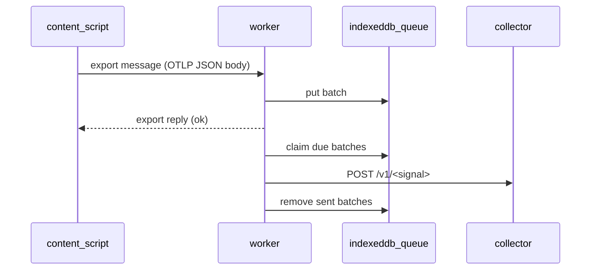

# @libo11y/webext

The libo11y Manifest V3 extension platform for TypeScript. It builds on
[`@libo11y/web`](https://github.com/jamesainslie/libo11y/tree/main/ts/packages/web).
`setupWorker()` runs in the extension's service worker. The browser can
stop the worker at any time, so the worker stores every batch in IndexedDB
before it sends it, and it drains the queue on every wake.
`setupContentScript()` runs in content scripts and extension pages. Those
contexts never post to the collector. They forward their batches to the
worker by runtime messaging. Trace context crosses with every traced
message, and consent is one state for the whole extension.

It has no RUM features. Those belong to `@libo11y/rum`, whose
`@libo11y/rum/webext` entry point builds on this package.

```sh
npm install @libo11y/webext
```

`@opentelemetry/api` is a peer dependency. npm 7 and later and Bun install
it automatically. If your application already depends on it, use a version
that satisfies `>=1.10.0 <1.11.0`.

## Quick start

`manifest.json`:

```json
{
  "manifest_version": 3,
  "name": "Clipper",
  "version": "1.4.0",
  "background": { "service_worker": "worker.js", "type": "module" },
  "content_scripts": [{ "matches": ["https://*/*"], "js": ["content.js"] }],
  "permissions": ["storage"],
  "host_permissions": ["https://otlp.example.com/*"]
}
```

`worker.ts`:

```ts
import { setupWorker } from "@libo11y/webext";

// At the top level, without a top-level await, so it runs on every wake.
const telemetry = setupWorker({
  serviceName: "clipper",
  environment: "production",
  endpoint: "https://otlp.example.com",
});

telemetry.then((t) =>
  t.onMessage(async () => {
    // Runs in the sender's trace context, so spans started here are its children.
    t.logger.info("clip received");
    return { saved: true };
  }),
);
```

`content.ts`:

```ts
import { setupContentScript } from "@libo11y/webext";

const telemetry = setupContentScript({ serviceName: "clipper", environment: "production" });

document.addEventListener("click", async () => {
  const t = await telemetry;
  await t.sendMessage({ kind: "clip", url: location.href });
});
```

Neither script uses a top-level `await`, and neither does the package's
test extension. Bundle each entry point for the browser. The package's own test extension
in `browser/fixture-extension` bundles its worker, content script and page
with `Bun.build` and `target: "browser"`.

The `storage` permission holds the shared consent state. Without it, each
context keeps its own state and content scripts start `pending`. The
collector's origin belongs in `host_permissions`.

## The service worker

Call `setupWorker` at the top level of the worker script, so it runs on
every wake. It registers its message listener before its first `await`, so
the message that woke the worker reaches it. Batches that arrive before the
telemetry is ready are answered once it is.

`setupWorker` takes core's `TelemetryOptions` and the
[`@libo11y/web` export options](https://github.com/jamesainslie/libo11y/tree/main/ts/packages/web#endpoints-and-cors):
`endpoint`, the per-signal endpoints, `headers`, `env`, `transport` and
`userAgent`. The worker uses the same endpoint order as the page.
Per-signal options come first, followed by `endpoint`, per-signal
environment values, and the common environment value. The worker
differs from the page `setup` in these ways:

- Every batch is put in the IndexedDB queue, leased, before its first
  attempt. It is removed after a success or a fatal error and rescheduled
  after a retryable one.
- Requests are always normal `fetch` requests, gzip-compressed when
  `compression` allows. The worker has no `sendBeacon` and no unload mode.
- The span and log batch delays default to 1000 ms and the metric export
  interval to 15000 ms, because the worker can stop at any time.
  `OTEL_BSP_SCHEDULE_DELAY`, `OTEL_BLRP_SCHEDULE_DELAY` and
  `OTEL_METRIC_EXPORT_INTERVAL` in `env` override them.
- The manifest's `version` is the detected `service.version`. A
  `service.version` in `OTEL_RESOURCE_ATTRIBUTES` beats it, and the
  `serviceVersion` option beats both, as resource layers merge in core.
- The console sink defaults to off.
- `setupWorker` rejects when there is no `chrome.runtime`.
- `telemetry.shutdown({ timeoutMillis })` keeps one deadline for the
  providers and the delivery, as on a page. A batch still on the wire when
  it passes is aborted and stays in the queue for the next wake. Shutdown
  also removes every listener the handle added, the traced ones from
  `onMessage` included.

| Worker option     | Default                  | Effect                                                                                                                             |
| ----------------- | ------------------------ | ---------------------------------------------------------------------------------------------------------------------------------- |
| `consent`         | `{}`                     | the initial state and the privacy signals, as in `@libo11y/web`. A stored state beats `initial`                                    |
| `fetch`           | `true`                   | client spans for the worker's own `fetch` calls. Pass `false` to turn them off, or `{ propagateTo, ignoreUrls }` to configure them |
| `acceptForwarded` | `true`                   | accept export batches from content scripts and extension pages                                                                     |
| `contextManager`  | `createContextManager()` | as in `@libo11y/web`                                                                                                               |

The worker accepts export messages only from its own extension's contexts,
whose `sender.id` equals `chrome.runtime.id`. It re-reads the stored
consent before it accepts each batch, so a grant or revoke in another
context counts before the storage change event reaches the worker.

`telemetry.sendTabMessage(tabId, payload)` sends a traced message to a
tab's content script through `chrome.tabs.sendMessage`. It rejects where
`chrome.tabs` is unavailable.

## Content scripts and extension pages

`setupContentScript` takes core's `TelemetryOptions`, `env`, `userAgent`,
`contextManager` and `instrumentations`. It has no endpoint options. Every
signal's batches go to the worker as export messages, and the worker posts
the body to the collector unchanged.



The worker replies once the batch is in its queue. It refuses the batch
when consent is not granted, when the message is malformed, or when the
queue refuses it. The content script drops a refused batch and reports it
through diag. No reply, a rejected `sendMessage`, or no answer within
10 seconds is retried from a memory queue in the content script.

| `instrumentations` option   | Default                                                  | Effect                                                                                                                           |
| --------------------------- | -------------------------------------------------------- | -------------------------------------------------------------------------------------------------------------------------------- |
| `fetch`, `xhr`              | `true`                                                   | client spans for this context's own requests. A content script runs in an isolated world, so it does not see the page's requests |
| `documentLoad`              | `false` in a content script, `true` in an extension page | the `documentLoad` span. A content script's document is the page's                                                               |
| `propagateTo`, `ignoreUrls` | `[]`                                                     | as in `@libo11y/web`                                                                                                             |

An extension page is a context whose protocol is `chrome-extension:`,
`moz-extension:` or `safari-web-extension:`. Both kinds of context flush
when their document is hidden.

## Consent

Consent is one state for the whole extension, stored in
`chrome.storage.local` under `libo11y.consent`. The worker reads it on every
wake, and a stored state beats `consent.initial`. When nothing is stored
yet, the worker stores a `granted` or `denied` initial state for the
content scripts to read. A content script starts from the stored state, or
`pending` when none is stored.

Every context writes its changes to storage and applies changes from other
contexts. `grant()` and `revoke()` in any context change consent for the
whole extension. A revoke anywhere clears the worker's IndexedDB queue and
each context's buffers, as `revoke()` does on a page. A revoke made while
the worker was stopped counts too: a worker that wakes to `denied` clears
the queue before its delivery can send anything, and so does a worker
whose `consent.initial` or respected privacy signal starts it `denied`. A
worker that wakes to `pending` keeps the queue. A stored state never moves
back to `pending`.

The worker's `consent` options decide the privacy signals for the whole
extension. When a respected DNT or GPC signal refuses a stored grant, from
a content script or an earlier wake, the worker stores `denied` in its
place. Every context then revokes, so the signals deny everywhere.

## Traced messaging

Both handles have `sendMessage(payload)` and `onMessage(listener)`.
`sendMessage` wraps the payload with the active trace context and resolves
with the listener's result. It rejects with the listener's error message,
or when no traced listener answered. `onMessage` runs the listener inside
the sender's context, so spans it starts are children of the sender's
active span. A returned promise is awaited, and its value is the reply.
`onMessage` returns a function that removes the listener.

Payloads cross `chrome.runtime.sendMessage`, so they must survive the
browser's JSON serialization of runtime messages.

## The message protocol

Every libo11y message is a plain JSON object with `libo11y: 1`
(`PROTOCOL_VERSION`). libo11y listeners ignore every other message, and
other listeners in the extension keep working. Do not send messages with a
`libo11y` field of your own.

| `type`         | From                   | Fields                                           | Meaning                                                                                |
| -------------- | ---------------------- | ------------------------------------------------ | -------------------------------------------------------------------------------------- |
| `export`       | content script or page | `signal` (`traces`, `metrics` or `logs`), `body` | one OTLP/HTTP JSON request body for the worker to queue and send                       |
| `export-reply` | worker                 | `ok`, `reason` when refused                      | the batch is queued, or the reason it was refused                                      |
| `traced`       | any context            | `carrier`, `payload`                             | an application message with `traceparent`, and `tracestate` and `baggage` when present |
| `traced-reply` | the listener's context | `ok`, `result` or `error`                        | the listener's result, or its error message                                            |

## Known limitations

- The test suites load the extension in Chromium only. `getChrome()` falls
  back to `globalThis.browser` where `chrome` is absent, and no other
  browser is tested.
- A content script's retry queue is in memory. Batches it could not hand
  to the worker are lost when the page closes.
- Only the worker reads DNT and GPC, through its `consent` options. A
  content script's `grant()` returns `"granted"` even when the worker's
  signals will refuse it. It records until the worker's refusal comes back
  through storage, and the worker refuses those batches.
- Delivery from the worker's queue is at least once. A worker stopped after
  its request reached the collector, but before it removed the batch, sends
  the batch again on the next wake. The worker is the only user of its
  queue, so a new wake releases every lease the stopped one held and sends
  those batches at once, without waiting for the leases to run out.
- `onMessage` needs the handle, so a traced listener is added only after
  `setupContentScript` resolves. A traced message that reaches a content
  script before then is not answered by it. The worker holds up to 100
  traced messages from its own extension that arrive before its listeners
  exist. It replays them one task after `setupWorker` resolves, to the
  listeners added by then, so add the worker's listeners in the first
  `then` of `setupWorker`.
- The worker has no XHR and no document-load span.
